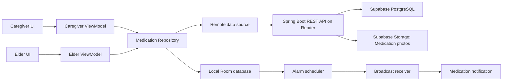

# Architecture

Current behavior: [ADR-0008 / ELDER_REMINDER_V2](adr/0008-photo-first-elder-reminders-and-caregiver-handoff.md). Protocol work remains in the [technical queue](ELDER_UI_TECHNICAL_REVIEW.md); compiled r1 declarations/tests are not V2 acceptance.

## Why this architecture exists

Six people need to work in parallel without waiting for every screen or backend endpoint to be finished. The architecture therefore separates UI, application state, data access, shared contracts, and server implementation.

The project starts with the smallest useful separation. It should not be split into many Gradle modules until a demonstrated need exists.

## System view



Room, remote networking, alarms, and persistent server storage are the P0 target components. The current scaffold uses an in-memory repository and store only as a temporary implementation; it is not the product boundary.

## Confirmed hosting and storage

The project lead confirmed the following stack on 2026-10-16; see [ADR-0004](adr/0004-hosting-storage-and-explicit-sync.md).

| Component | Confirmed responsibility |
|---|---|
| Android Room | Local data source for screens, persisted reminder execution, and locally recorded Elder actions |
| Render | Runs the Spring Boot application service |
| Supabase PostgreSQL | Structured business data, including identities, care relationships, Medication metadata, Reminder plans, and Dose events |
| Supabase Storage | Medication photo objects |
| Local deployment configuration | Fully cloud-independent Spring Boot + local PostgreSQL + private local-file Storage; rehearsed two-device LAN fallback |

Android synchronizes application data explicitly between Room and the Spring Boot API. Spring Boot remains the authentication, care-relationship authorization, and validation boundary. Choosing Supabase storage does not change anonymous login/JWT into Supabase Auth. Realtime database subscriptions are not mandated; required timely alerts need their own reviewed delivery mechanism, not manual refresh alone.

T07 was approved on 2026-10-16: the local fallback must run the same Spring Boot artifact with local PostgreSQL and a private local-file Storage adapter, with no Render/Supabase/cloud-auth/content/download runtime dependency. Preprepare dependencies/APKs and perform the complete real two-device LAN flow with cloud egress disabled, including restart persistence and offline recovery. Environment profiles isolate sessions, Room, outbox and upload intents; cloud identities/pending actions never migrate automatically. Both Storage adapters enforce the same protected-content, staging/READY and safe-cleanup Interface. See [ADR-0006](adr/0006-cloud-independent-demonstration-fallback.md). These are accepted requirements, not implemented scaffold functionality.

## Module responsibilities

### `android-app`

Owns Android screens, lifecycle, local persistence, synchronization, camera integration, permissions, alarms, and notifications.

Main package boundaries:

- `caregiver`: caregiver screens and their ViewModels
- `elder`: elder screens and their ViewModels
- `pairing`: future pairing screens and logic
- `camera`: future photo capture and OCR adapter
- `core/data`: repository interfaces and data-source coordination
- `core/database`: future Room entities and DAOs
- `core/network`: future Retrofit client and JWT session implementation
- `core/reminder`: future AlarmManager and notification implementation

UI classes must not call a database or HTTP client directly.

### `shared`

Owns data exchanged between Android and server. It contains no Android UI and no database implementation.

Changing a shared model is an API change. Android and server owners must review it together.

### `server`

Owns authentication, relationships, Reminder plans, Dose events, photo metadata, persistence, and API validation. It is a Spring Boot application written in Kotlin. The current stores are in memory and must be replaced before a real demonstration.

## Anonymous authentication and JWT

The agreed P0 authentication flow is:

```text
first launch -> app generates random installation UUID -> anonymous login
anonymous login -> server creates or restores user -> signed access JWT
API request -> Authorization: Bearer <JWT> -> server validates signature and expiry
expired JWT -> repeat anonymous login with the same installation UUID
```

- The installation ID is an app-generated random UUID, not a phone hardware identifier.
- The server fixes one role to an installation after its first login.
- The JWT contains only the user ID, role, anonymous account type, issuer, and timestamps.
- The access token lasts 24 hours in the scaffold. P0 does not use refresh tokens.
- The server is stateless for request authentication; it does not create an HTTP session.
- The Android client must keep the installation ID and token in private app storage and must never log either value.
- Anonymous login identifies an installation. Pairing authorization is still required before a caregiver can access an elder's data.

The current anonymous user store is in memory, so user identities reset when the server restarts. Persistent users and a stable server database are required before the integrated demonstration.

## Android data flow

The intended direction is:

```text
XML/View -> Activity -> ViewModel -> Repository -> local or remote data source
XML/View <- Activity <- observable UI state <- Repository
```

- An Activity handles Android UI events and renders state.
- A ViewModel holds screen-level state and launches coroutines.
- A Repository is the entry point for application data.
- A data source deals with exactly one storage or network mechanism.
- Shared models describe the contract, not screen widgets.

If an Activity contains SQL, HTTP calls, or scheduling rules, the boundary has been broken.

## Source of truth and offline behavior

The shared service holds the mutually recognized Reminder plan version and accepted Dose event results. Room holds the last successfully synchronized local copy and drives Android screens and local reminders. Network responses update Room instead of bypassing it.

This rule allows an elder to see already synchronized plans while offline. It also gives the reminder scheduler a stable local source after the app process is closed.

Caregivers may view clearly marked cached data while offline but cannot create or edit Reminder plans offline. Elders may execute already synchronized plans offline. Elder actions are recorded locally first as `Pending sync`, retried automatically after connectivity returns, and become `Synced` only after service acceptance. Repeated submissions use one logical action identity and must not duplicate results. A rejected action remains preserved as `Sync needs attention`. These are data/diagnostic states, not ordinary Elder screen tasks; Caregiver mapping displays only received/known evidence.

The current in-memory repository is temporary. It lets screen owners build against the Repository boundary before Room and the API client are ready.

The development preview now exposes scoped caregiver and Elder/date observations rather than a global schedule list. It validates legacy fields, filters enabled plans over inclusive dates and refreshes today's date while observed. Its labeled demo identities and fixed Shanghai clock are local preview context only, not authenticated identity, confirmed P0 execution-zone data or relationship authorization. Server legacy routes separately enforce a fail-closed relationship-access seam whose current adapter denies all Caregiver access until real Pairing is connected.

## Approved occurrence and synchronization flow

Baseline `T01-T07/2026-10-16-r1`: confirmed plan/revisions → Elder Room → sole-generator rolling next 24 hours → atomic frozen event/evidence/registration work → authenticated registration or action with inline evidence → Server durable canonical event/receipt → authorized snapshot → scoped Room merge. Network arrival order never arbitrates historical meaning. Seven-day previews are derived candidates, not persisted Dose events. Edits/deactivation leave all generated events, including SCHEDULED, unchanged; UI explains retained instances. See [ADR-0005](adr/0005-occurrence-generation-and-time-resolution.md).

Room event/action/outbox and capability sequence/outbox writes are atomic. P0 keeps business/generated/pending/rejected evidence; history defaults (30 dates), preview (seven days) and snapshot caps (90 dates/10,000 entities) are not deletion/offline-expiry policies. Primary read-only Repeatable Read snapshots represent one authorized related-table view. Writes separately enforce current authorization, durable uniqueness and accepted-effect+receipt transactions. Request/access generations discard stale fetches; old receipts acknowledge only their own operation. Per-feature adapters own mappings with S1/S2 review.

## Reminder responsibilities

Medication reminders and background synchronization are different jobs:

- AlarmManager schedules user-visible medication times.
- A BroadcastReceiver creates the notification when an alarm fires.
- WorkManager retries uploads and performs deferrable synchronization without requiring the app to remain open.
- A boot receiver reloads future alarms from Room after device restart.
- The server never replaces the local medication alarm.

Exact-alarm and notification permissions need explicit denied-permission behavior. `Reminder delivery degraded` and `Reminder delivery unavailable` are capability conditions, not Dose event states and never imply `Missed`.
A persisted future reminder must be restored after reboot and first unlock. Only a non-taken, non-helped, non-taken-over Due event still inside its original thirty-minute Response window may restore; an expired event becomes Missed without an expired notification; Taken events are never replayed.

## Caregiver follow-up and device-contact supervision

Photo-first grouped reminders use one confirmation, ten-minute snooze or Help. The sole response interval is [plannedAt, plannedAt + 1_800_000ms); Help suppresses repeated prompting immediately, and cutoff removes old photos/notifications/actions. Local cutoff survives offline/recovery. A remote takeover is not represented as applied before Elder acknowledgement.

Caregiver contact requires a separate auditable Taken / Not taken / Unable to confirm entry, preserving actor/source, actual-time uncertainty and entry/receipt times. It neither impersonates an Elder action nor erases timely offline/conflicting reports. Independent device-contact monitoring alerts well before the ordinary nonresponse deadline, without guessing power/network cause. Medication follow-up and device recovery close independently.

These are current required capabilities, not P1. V2-T01–T05 must specify models/transactions/version migration, authenticated contact evidence and persistent/retried notification delivery, including offline Caregiver and local fallback. Neither WorkManager timing nor a stale snapshot alone proves contact-loss detection or delivery. Server expected-plan monitoring does not become a competing canonical event generator.

## OCR boundary

OCR extracts candidate text from a photo. It does not create a trusted medication plan.

The safe flow is:

```text
photo -> OCR candidate text -> caregiver review and correction -> saved Reminder plan
```

Manual entry remains available. OCR failure must not block the core workflow.

## State definitions

The shared dose states are:

- `SCHEDULED`: a future dose exists
- `DUE`: the reminder time has arrived
- `SNOOZED`: the user requested another reminder
- `TAKEN`: the elder confirmed completion
- `MISSED`: the thirty-minute Response window ended without a timely Taken report currently known; it does not prove non-adherence or notification delivery

Normal transitions are `SCHEDULED -> DUE`, `DUE -> SNOOZED`, `SNOOZED -> DUE`, `DUE/SNOOZED -> TAKEN`, and any non-final state to `MISSED` when the Response window expires. A Taken report recorded locally before the deadline may reconcile a provisional Missed result after synchronization. A UI label must not invent a state that the server cannot represent.

The fixed ten-minute snooze is measured from the locally recorded action time. If its target reaches or passes the original deadline, expiry takes precedence and no repeat notification is presented. The scheduler and recovery path both check the response window before presenting a repeat; receipt of a delayed action never restarts its timer. See the API contract and D03/O01 boundary vectors.

## Pairing and authorization boundary

An installation identity authenticates one installation and its fixed role; it does not authorize access to another person's data. Pairing creates a pending request, and authorization begins only after the elder explicitly accepts. In P0 one caregiver may relate to multiple elders, while an elder has at most one active caregiver. Every cross-user operation checks the authenticated subject and active care relationship. Either participant may revoke the relationship; revocation blocks subsequent caregiver access and changes while preserving the elder's own access.

The P0 walking skeleton includes a real Elder-to-Caregiver Medication photo handoff before the caregiver confirms the first Reminder plan. The photo is a reference, not proof of identity, dosage, or ingestion; OCR never makes a plan authoritative.

## Security and privacy rules

- Use fictional medication data during development and demonstrations.
- Do not log photos, tokens, dosage text, or personal identifiers.
- Keep secrets outside Git and inject them through local configuration.
- Collect only data needed for reminders and caregiver feedback.
- Do not describe the system as diagnosing, prescribing, or verifying ingestion.
- Development permits local HTTP traffic; release configuration must not silently allow arbitrary cleartext traffic.

## Remaining implementation design decisions before replacing the fakes

1. Room schema, server schema, and the concrete idempotency representation.
2. Supabase PostgreSQL migrations, Supabase Storage integration, Render environment configuration, and the tested local fallback setup; provider selection is settled by ADR-0004.
3. Concrete API routes and final JSON shapes consistent with `docs/API_CONTRACT.md`.
4. Android class structure for pairing, photo upload, Room, alarms, boot restoration, and WorkManager.

The product decisions above are settled in the Wayfinder map and are not reopened by these implementation choices.
