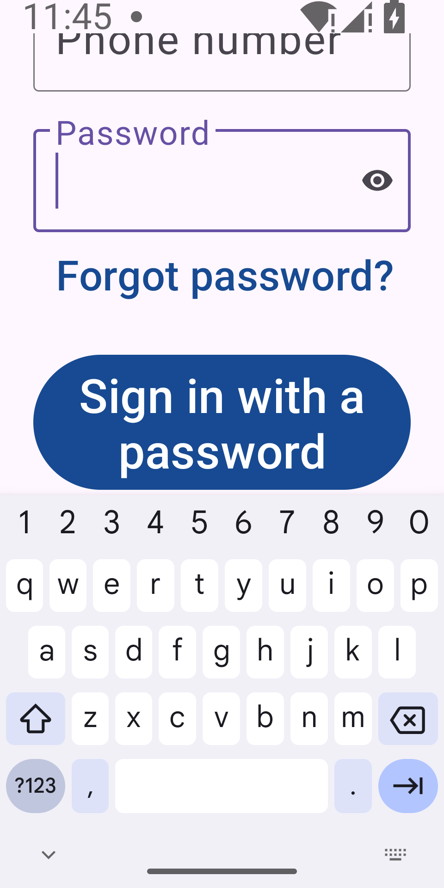
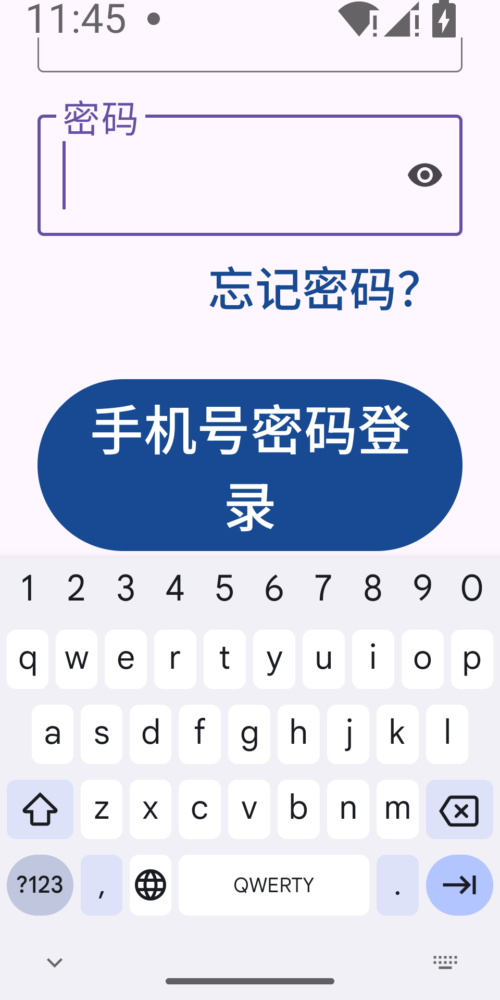
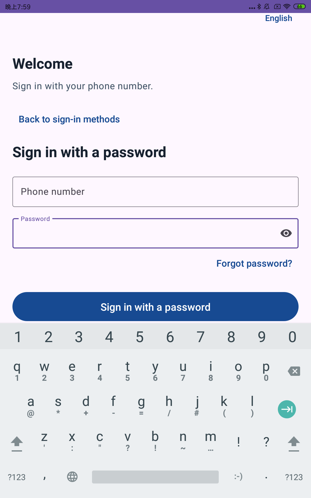
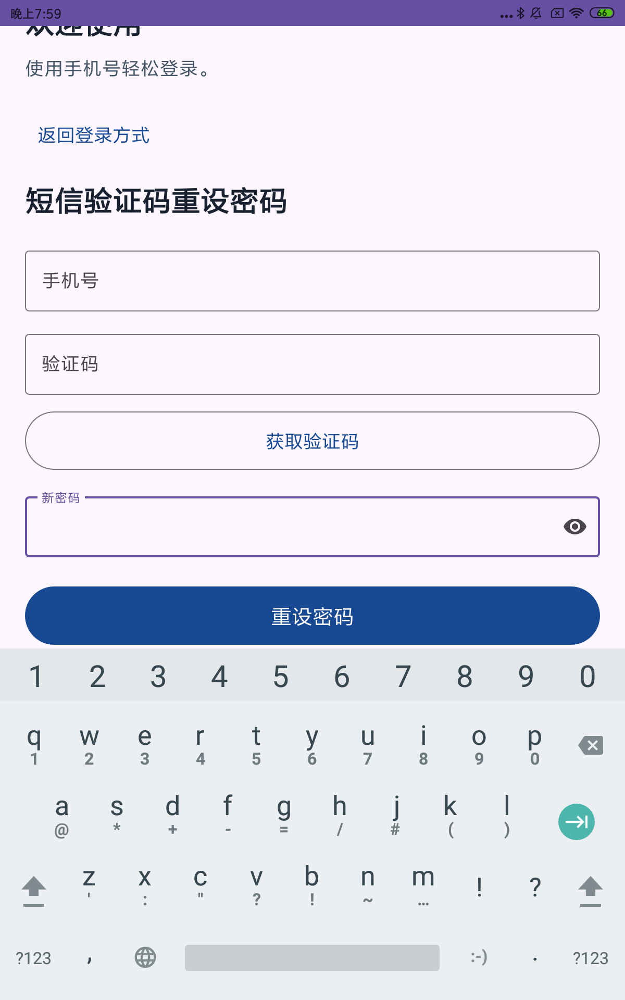

# Shared login keyboard visibility correction

Refs #19. Owner: tianiridescent (C1). The original correction used
`fix/19-login-keyboard-insets` from main `dc1e2fb` and was merged in #117.
The follow-up uses `test/19-c1-keyboard-focus` from main `bbe4997`.
Required review: non-author Android/UI and E
accessibility perspectives under the team roster. This slice does not depend on
unmerged #88 or #112 and does not complete all #19 acceptance.

## 2026-11-20 follow-up result (local, not published)

The return-stage failure was reproduced in landscape on Mi Pad 4 Plus/API27.
Portrait alone passed and was not used to dismiss the earlier failure. A temporary
touch/scroller probe showed that the return button received no DOWN/UP while the
NestedScrollView's OverScroller was still unfinished, despite an unchanged visible
scroll position (`curr=876`, `final=876`, `visible=437`). After the existing 500ms
animation-settlement action, the scroller finished; the same physical tap reached
the button and displayed login choices. The diagnostic reflection/listener was
removed from the final test. No production Activity, layout or authentication
code changed.

The regression now settles the initial keyboard/rotation state and the return
scroll before tapping. It retains the focused-field bounds, actual IME, complete
submit visibility, physical submit tap and returned-choice visibility assertions.
Optional `c1KeyboardOrientation=portrait|landscape` changes only the test Activity,
not device settings. `c1KeyboardEvidenceRun` gives each run unique screenshot names
so stale files cannot be mistaken for evidence from that run. Failures retain a
screenshot and are rethrown.

Final same-APK device results: landscape 6/6 (39.191s), portrait 6/6 (34.196s),
zero failures/errors/skips. Both cover English/Chinese SMS, password and reset
preview forms. Representative bilingual screenshots in both orientations were
visually checked. App SHA-256 remains
`75f9cda7313248d7000f9e512c471a4b80ca01c9cbf7e9d2a71d7bf3f5971be6`;
test APK SHA-256 is
`fc48d7820b197a3af2d913912bd0274397af73720eafb50016fd2fff54400cce`.
The unchanged app hash also matches the earlier failing investigation.

```text
gradlew.bat -I .git/c1-local-recovery-20261117/pr127-sync/tablet.init.gradle :android-app:assembleDebug :android-app:assembleDebugAndroidTest :android-app:lintDebug --offline --no-daemon --max-workers=1 --no-parallel --console=plain
python .git/c1-local-recovery-20261117/keyboard-followup-20261120/run_orientation.py final-landscape:landscape final-portrait:portrait
```

Final build passed in 3m18s; lint reported zero errors and 42 warnings.
Raw commands, source/APK hashes, screenshots, initial failed orientation run and
diagnostic probe logs remain under the local `keyboard-followup-20261120` directory
above. The initial landscape run failed 6/6: its first case reproduced the return
failure; later cases also had input-injection/setup failures and are not six
independent product defects. The earlier three failures remain in the historical
record below. Device size/density/font settings and the original application/data
were untouched; only the isolated `.c1review127` package was installed and stopped.

This resolves the investigated automated return failure, not real phone login,
all accessibility acceptance or a fresh human keyboard-obstruction acceptance.
The initial investigation did not rerun JVM/Server suites; separate delivery
checks below now cover them. There is no new product behavior requiring a repeated
human check in this slice. Publication remains pending, separate from PR #127.

### Independent delivery checks from main bbe4997

The four-file delivery is on `test/19-c1-keyboard-focus`: this test, this evidence,
the contribution entry and their integrity manifest. It contains no production
change or unmerged #127 code. The original working directory and its user-modified
`gradle.properties` remain untouched.

Actual Windows Android execution: Debug 130/130 and Release 129/129, zero
failures/errors/skips. Lint: zero errors, 42 warnings. Debug and instrumentation
APK builds passed; combined command completed in 6m33s. Actual Linux execution:
Server 628/628 and Shared 18/18, zero failures/errors/skips (2m46s). Server was
excluded only from the Windows command and executed separately on Linux, keeping
the POSIX security assertions intact. Tests use the same candidate sources.

```text
gradlew.bat test -x :server:test :android-app:lintDebug :android-app:assembleDebug :android-app:assembleDebugAndroidTest -I ../group33/.git/c1-local-recovery-20261117/pr127-sync/tablet.init.gradle --offline --no-daemon --max-workers=1 --no-parallel --console=plain
GRADLE_RO_DEP_CACHE=/mnt/c/Users/22689/.gradle/caches ./gradlew :server:test :shared:test -I ../group33/.git/c1-local-recovery-20261117/keyboard-followup-20261120/linux-keyboard.init.gradle -I ../group33/.git/c1-local-recovery-20261117/keyboard-followup-20261120/execute-tests.init.gradle --project-cache-dir /root/.cache/group33-keyboard-gradle --offline --no-daemon --max-workers=1 --no-parallel --console=plain
python scripts/check_repository_policy.py
git diff --check
```

Linux initial startup failed before tests with an ExecutionHistoryStore I/O
error; logs remain in `branch-linux.log`. A separate Linux project cache resolved
startup. The next run restored cached test reports; those are not claimed as
actual test execution. The final `branch-linux-executed.log` disables Test task
cache/up-to-date reuse without changing tests or assertions. XML reports and exact
commands are retained with `branch-windows.log` and `branch-linux-reports.zip` in
the existing local evidence directory above.

The delivery product APK is byte-identical to the device-tested app hash above.
All eight compiled `SharedLoginKeyboardTest` class files and its source are also
byte-identical. The delivery instrumentation APK differs because unrelated #127
tests are absent; its SHA-256 is
`830e0000747b0ea89533542f4f58151aa4194aca9e2a14d81d54649fc9884bb2`.
The 12 API27 results above are reused on that verified code identity, not described
as another device run or as a device run of this new APK. New API35 focus checks,
fresh human acceptance, real phone authentication and formal review remain outside
these results. No commit, push, new PR or Ready promotion has been performed.

## 2026-11-17 follow-up investigation (historical local result)

The owner passed bilingual login-form entry/return during #127 acceptance, but
reported keyboard obstruction, especially for phone/code fields. This remains
an open hands-on finding. The earlier fix was merged in PR #117 (`1b9c133`);
`SharedLoginActivity.kt` in the current workspace is byte-identical to that
merged file. Its IME/system-bar padding and `adjustResize` are present. No
production code was removed or changed during this investigation.

The installed isolated candidate is `com.group33.medicationreminder.c1review127`.
The device also has a separate older `.review113` installation, observed in the
foreground during investigation. That observation identifies a possible version
mix-up; it does not establish that every reported obstruction occurred there.
Neither the older package nor its data was removed or replaced.

The existing keyboard regression was extended locally to check the focused phone
field and subsequent code/password fields while a real IME is open, without a
test-induced scroll after focus changes. Complete field bounds must be contained
in the visible rectangle and end above the measured keyboard top. The earlier
submit-button visibility/click/return assertions remain in place.

On the landscape API27 Mi Pad 4 Plus, all focused-field checks were reached and
passed across the six bilingual SMS/password/reset cases. The entire group is
**not green**: successive runs returned 3/6, with Chinese SMS, English SMS and
English password failing at the final return-to-login-choice assertion. Bounded
IME-dismissal/layout/position waits did not resolve those final failures. Their
root cause remains open; it is not established as mere timing or as a production
input-obstruction regression. No assertion or failed case has been skipped.

An earlier attempt lost the resumed Activity while the older app was foreground;
another initial probe incorrectly required exact equality between a TextInput
visible rectangle and its field height. Those attempts are retained as invalid
diagnostics, not proof of an application defect. The rectangle probe now checks
containment of the complete field bounds.

Actual verification:

```powershell
.\gradlew.bat -I .git/c1-local-recovery-20261117/pr127-sync/tablet.init.gradle :android-app:assembleDebugAndroidTest :android-app:lintDebug --offline --max-workers=1 --no-parallel --no-daemon
python .git/c1-local-recovery-20261117/pr127-sync/keyboard-focus/run-focused-keyboard-settled.py
```

Build/lint exited 0; the final device command exited 1 (3 passing / 3 failing).
Commands, APKs, focus samples and reports are retained locally under
`.git/c1-local-recovery-20261117/pr127-sync/keyboard-focus/`.
The existing production APK in this isolated package remains SHA-256
`75f9cda7313248d7000f9e512c471a4b80ca01c9cbf7e9d2a71d7bf3f5971be6`.
Focused-input hands-on reproduction in the explicitly selected candidate is the
next check. This keyboard investigation is separate from #127 publication and
does not authorize any upload or claim keyboard acceptance complete.

## Problem and correction

At API35, 320dp portrait and system font scale 2.0, the main password form could
scroll its submit button partly behind the real keyboard. The final baseline
regression run failed both English and Chinese password cases: button bottoms
1219/1176px versus keyboard top 1071px. SMS and reset cases passed that baseline
run; the older broad failure count from exploratory measurements is not used.

SharedLoginActivity now explicitly opts into consistent edge-to-edge handling and
applies the union of system-bar, cutout and IME insets to its root. The scroll
viewport ends above the keyboard, allowing the complete submit button to be
scrolled into view. Manifest explicitly requests `adjustResize` so compatible
keyboard insets are available. Insets are combined by maximum, not added together.
See [Android's keyboard guidance](https://developer.android.com/develop/ui/views/layout/sw-keyboard).

No authentication, navigation decisions, API, Shared model, storage, permissions,
strings or phone-provider integration changed. Password/reset submission still
reports its existing preview-only boundary; this is not real sign-in acceptance.

## Verification

- Debug and Release JVM suites: 121 tests each, zero failures/errors.
- Shared JVM suite: 18 tests, zero failures/errors.
- Debug lint: zero errors, 28 warnings. Debug/Release and instrumentation APKs built.
- API35 real Gboard, 320dp portrait, font scale 2.0: six tests passed, covering
  English/Chinese SMS, password and reset (45.208s).
- API35 real Gboard, 360dp portrait, font scale 2.0: six tests passed (46.762s).
- API35, 360dp portrait, normal font scale 1.0: six tests passed (45.248s).
- Physical Mi Pad 4 Plus, Android8.1/API27, original size/density/font settings:
  six English/Chinese keyboard cases passed (21.529s). Screenshots were inspected
  for full submit visibility above the keyboard. Total device cases: 24 passing.
- Member manually inspected the repair on the physical tablet and reported no
  remaining issue on 2026-11-07, then authorized publication. The language toggle
  continues to display the current language, following the existing #19 rule.
- Each case opens the final field and a real keyboard, scrolls to submit, waits
  for keyboard/scroll frames, checks the complete button is above the IME, taps
  it to reveal inline status, dismisses the keyboard and returns to login choices.
- Assertions use full-screen display bounds rather than subtracting IME twice
  from a legacy decor that may already be resized. No fullscreen/multiwindow claim
  is made beyond the tested portrait configurations.

Automated keyboard checks are not a complete TalkBack, contrast, grayscale or
production-phone-authentication acceptance. The API27 run used a temporary isolated `.keyboard19` package; the existing
`.review113` pairing application and its data were preserved. The temporary app
and test package were removed after retrieving screenshots. No tablet display or
font settings were changed. Current-head GitHub CI is pending publication. No Server/Shared source changes; the known
Windows POSIX Server-test limitation is not silently reported as a passing full
local gate.

## Reproduction

Build with the project JDK17/SDK35 setup:

```text
gradlew :android-app:testDebugUnitTest :android-app:testReleaseUnitTest :shared:test :android-app:lintDebug :android-app:assembleDebug :android-app:assembleRelease :android-app:assembleDebugAndroidTest
adb shell wm size 960x1920
adb shell wm density 480
adb shell settings put system font_scale 2.0
adb shell settings put secure show_ime_with_hard_keyboard 1
adb shell am instrument -w -e class com.group33.medicationreminder.SharedLoginKeyboardTest <test-package>/androidx.test.runner.AndroidJUnitRunner
```

The 360dp variant uses 1080x2160 at density480. These size/font overrides were
applied only to an agent-started read-only emulator. The external debug suffix
`.keyboard19` isolates its data from the existing review application; applicationId
in source is unchanged. Restore test-device settings after running.







## Rollback

Revert the Activity inset handling and Manifest resize change. There is no data
migration or deployed configuration change. Raw logs and the baseline APK stay
outside Git under `D:/w/review-20261107/keyboard19*`.

### 2026-11-22 latest-main keyboard and Debug component fixtures

Prepared independently from main b5acc05224612bf25797ee71a5cdf1a879b67d91,
Refs #19. Only SharedLoginKeyboardTest, CaregiverEventRowViewTest and the
non-exported Debug CaregiverEventRowTestActivity change, plus this existing
evidence, CONTRIBUTIONS and the artifact manifest. Production src/main, Release,
auth/pairing/session, Server/Shared, DTO/API and build configuration are unchanged.
The old four-file keyboard worktree remains intact. This delivery is not mixed
into #112 or #127; those syncs preserve the exact main component files.

The full Android Debug/Release JVM suites actually executed 135/134, zero
failures/errors/skips, lint zero errors/32 warnings, three APK builds succeeded;
Shared was UP-TO-DATE and Server unchanged/not rerun. Those reports belong to
the d896122 source candidate. Subsequent changes only affect instrumentation and
the manifest: unit/production/Debug host sources and app/Release APK bytes remain
identical. Each new instrumentation candidate was rebuilt successfully with:

```text
gradlew.bat :android-app:assembleDebugAndroidTest -PdebugServerUrl=http://127.0.0.1:18087 -I ../group33/.git/c1-local-recovery-20261117/login-isolated.init.gradle --offline --no-daemon --max-workers=1 --no-parallel --console=plain
adb -s 9c69cae2 shell am instrument -w -r -e class com.group33.medicationreminder.caregiver.CaregiverEventRowViewTest com.group33.medicationreminder.c1dev88.test/androidx.test.runner.AndroidJUnitRunner
adb -s 9c69cae2 shell am instrument -w -r -e class com.group33.medicationreminder.SharedLoginKeyboardTest -e c1KeyboardOrientation landscape -e c1KeyboardEvidenceRun main-20261122-settled-landscape com.group33.medicationreminder.c1dev88.test/androidx.test.runner.AndroidJUnitRunner
adb -s 9c69cae2 shell am instrument -w -r -e class com.group33.medicationreminder.SharedLoginKeyboardTest -e c1KeyboardOrientation portrait -e c1KeyboardEvidenceRun main-20261122-settled-portrait com.group33.medicationreminder.c1dev88.test/androidx.test.runner.AndroidJUnitRunner
```

Mi Pad 4 Plus API27: component 7/7, keyboard landscape6/6 + portrait6/6.
Both languages and SMS/password/reset forms use the real IME; focus movement
must reveal each input without test scrolling. The submit button must be fully
visible above the keyboard and accept a physical Espresso tap; return reaches
the method chooser. Screenshots are unique per execution. These are UI/fixture
checks, not successful phone authentication. No new API35/system200%/TalkBack,
two-installation or real supplier acceptance is claimed. Prior screenshots and
human acceptance remain tied to their earlier named versions.

Retained failures and the minimal repairs:

- Exact main component baseline: 5/7, plus UiAutomation teardown failure; both
  failed methods reproduced independently. Debug host now explicitly enables
  edge-to-edge before requesting insets. Screenshot capture runs on the
  instrumentation thread, never blocks the main looper establishing UiAutomation.
- With those repairs, 6/7 exposed an impossible viewport assumption: the 200%
  configured-font report was1286px tall in a1150px landscape viewport. The test
  now scrolls to and asserts both report beginning and ending inside safe system
  bounds. It retains the overflowing fixture, font/width, inset and wrapping checks;
  no content is shortened or font reduced to force a pass.
- Initial keyboard landscape checks were4/6 (extra tap raced password IME), then
  2/6 after removing that tap (scroll bounds were computed before IME switch).
  The already-focused input is not redundantly tapped; the existing keyboard
  settle action now runs before computing submit scroll bounds as well as after.
  Visibility, focus, real IME, full button height, physical submit and return
  assertions remain; no timeout increase or retry-to-green was introduced.

Raw logs/results, frozen APKs/source trees and screenshots remain under the
local c1-main-keyboard* evidence. Component7/7 used the final component candidate;
the later keyboard-only refinement has identical component/host/app bytes.
All failed candidates remain attributable and are not overwritten by final runs.
The isolated c1dev88 package alone was exercised, no original app data cleared,
no global orientation/font/IME setting changed. Repository policy/diff checks and
393 raw-Git-blob manifest hashes passed. No additional human acceptance is needed
for test-only changes; C3/S1/E and a non-author still review the published candidate.

## Current-main follow-through — 2026-11-27

Agent-assisted C1 preparation; no human approval or signature.

Integrated actual main `9ae5bbcd2baa11222f1fb2b7dc13634159b773a8` while preserving both contribution histories.

Android Debug/Release JVM results (actual reports): `{"testDebugUnitTest": {"tests": 275, "failures": 0, "errors": 0, "skipped": 0}, "testReleaseUnitTest": {"tests": 274, "failures": 0, "errors": 0, "skipped": 0}}`.

Debug lint: `{"Warning": 59}`. Debug/Release/AndroidTest APK builds passed.

Physical MI PAD 4 PLUS / API27: **13/13**, all unique test completions status0.

System settings retained: font1.0,1200x1920,density320. Tests use fictional fixtures; no supplier/cloud acceptance.

Temporary application package: `com.group33.medicationreminder.c1review140`; existing tablet applications/data preserved.

APK SHA256: `{"android-app-debug.apk": "6de30944887314400166251b2692a162e27146946bb18a9176d3620c67f1a7ad", "android-app-debug-androidTest.apk": "d66d37a6cef77bf64ac285d8af83081cb5e525b3f19dc82516f8a2b7a424164a"}`.

Preserved off-main screenshot capture, real-IME/focus/click assertions and oversized paragraph beginning/end reachability.

Kept main’s600dp viewport fixture; did not restore main-thread screenshot capture or whole-paragraph visibility assumptions.

Device checks cover this combination, not system200%/TalkBack or full feature acceptance. Current-head independent reviewers remain required.

Raw build/device results and APK hashes are retained privately under `.git/c1-progress-20261127/`.

Policy, whitespace and regenerated complete artifact manifest are checked before publication.

## Follow-through after main #122 — 2026-11-27

Integrated main `08f901ac4e44393dc850459caf3924e463f3f5c9` after it advanced during publication. Agent-assisted evidence, no human signature.

Current Debug JVM results: `{"tests": 277, "failures": 0, "errors": 0, "skipped": 0}`.

Physical API27 repeated: **15/15**, unique status0 completions.

Current Debug lint: `{"Warning": 59}`; Debug/test APK build passed.
Command: `gradlew -I <private-isolation-init> :android-app:testDebugUnitTest :android-app:lintDebug :android-app:assembleDebug :android-app:assembleDebugAndroidTest --offline --max-workers=1`.
The earlier Release274 tests and Release APK belong to main9ae5bbcd; they are not newly executed Release acceptance on main08f901ac. Full final-head CI remains required.

Current APK SHA256: `{"android-app-debug.apk": "e13c416d92bc3fee456dac97c58b719e3ebfee7d467ca755f855fa7fa89bdf6c", "android-app-debug-androidTest.apk": "77dbefefad6d50175cda24e01e39d536b551593f6a709b917302d1f19917bdd8"}`.

Inspection of the first global-window captures found unrelated background content during transitions. Those captures were rejected and not committed/uploaded.
The Debug-only host now uses an opaque shared-token background. Captures draw only the attached test decor on main; PNG encoding/writing remain off main. This is not compositor/system-font/TalkBack acceptance. All15 checks pass, including the two additional main#122 cases.

System settings and existing tablet apps/data were retained. No new real-provider or production feature acceptance is asserted.
