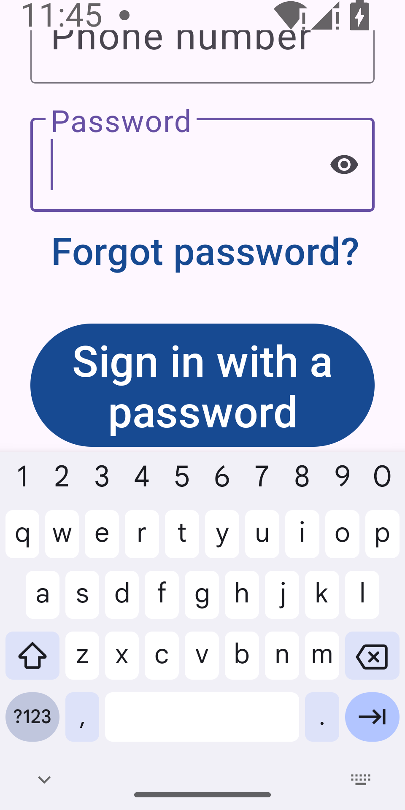
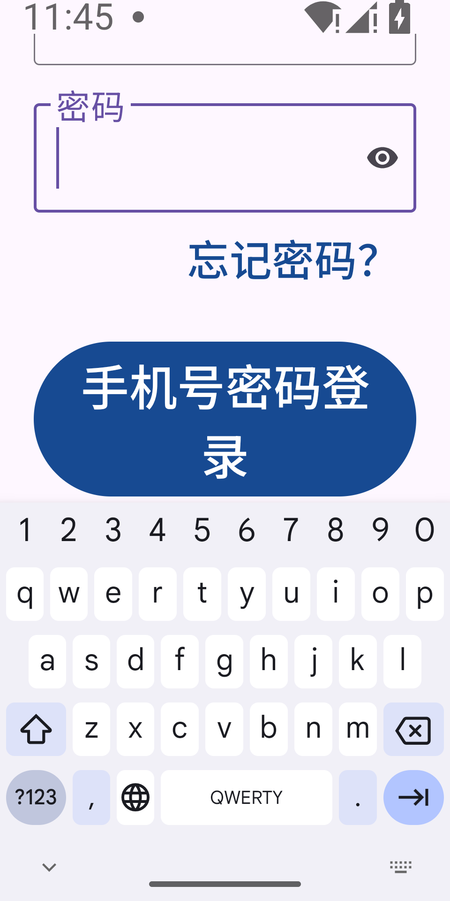
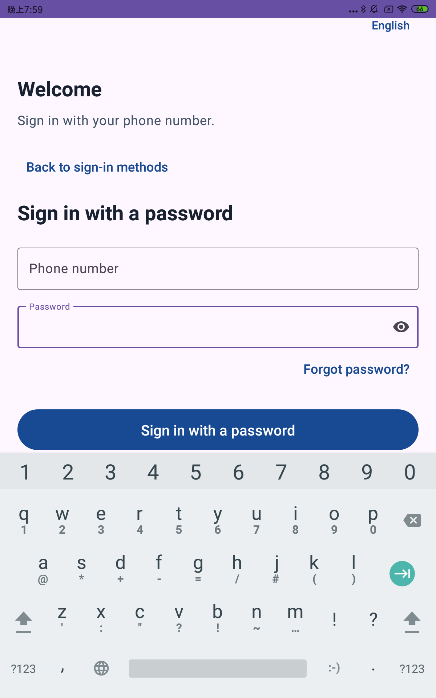
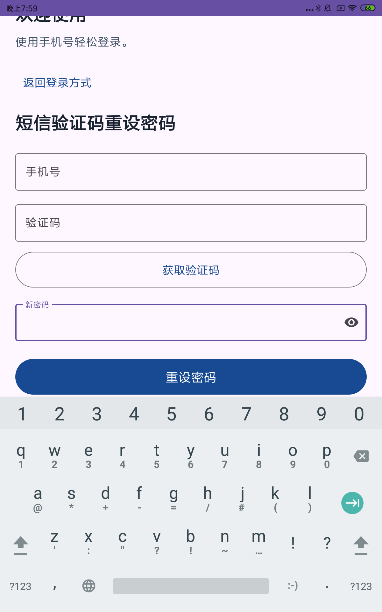

# Shared login keyboard visibility correction

Refs #19. Owner: tianiridescent (C1). Branch: `fix/19-login-keyboard-insets`,
from current main `dc1e2fb`. Required review: non-author Android/UI and E
accessibility perspectives under the team roster. This slice does not depend on
unmerged #88 or #112 and does not complete all #19 acceptance.

## Problem and correction

At API35, 320dp portrait and system font scale 2.0, the main password form could
scroll its submit button partly behind the real keyboard. The final baseline
regression run failed both English and Chinese password cases: button bottoms
1219/1176px versus keyboard top 1071px. SMS and reset cases passed that baseline
run; the older broad failure count from exploratory measurements is not used.

SharedLoginActivity now explicitly opts into consistent edge-to-edge handling and
applies the union of system-bar, cutout and IME insets to its root. The scroll
viewport ends above the keyboard, allowing the complete submit button to be
scrolled into view. Manifest explicitly requests `adjustResize` so compatible
keyboard insets are available. Insets are combined by maximum, not added together.
See [Android's keyboard guidance](https://developer.android.com/develop/ui/views/layout/sw-keyboard).

No authentication, navigation decisions, API, Shared model, storage, permissions,
strings or phone-provider integration changed. Password/reset submission still
reports its existing preview-only boundary; this is not real sign-in acceptance.

## Verification

- Debug and Release JVM suites: 121 tests each, zero failures/errors.
- Shared JVM suite: 18 tests, zero failures/errors.
- Debug lint: zero errors, 28 warnings. Debug/Release and instrumentation APKs built.
- API35 real Gboard, 320dp portrait, font scale 2.0: six tests passed, covering
  English/Chinese SMS, password and reset (45.208s).
- API35 real Gboard, 360dp portrait, font scale 2.0: six tests passed (46.762s).
- API35, 360dp portrait, normal font scale 1.0: six tests passed (45.248s).
- Physical Mi Pad 4 Plus, Android8.1/API27, original size/density/font settings:
  six English/Chinese keyboard cases passed (21.529s). Screenshots were inspected
  for full submit visibility above the keyboard. Total device cases: 24 passing.
- Each case opens the final field and a real keyboard, scrolls to submit, waits
  for keyboard/scroll frames, checks the complete button is above the IME, taps
  it to reveal inline status, dismisses the keyboard and returns to login choices.
- Assertions use full-screen display bounds rather than subtracting IME twice
  from a legacy decor that may already be resized. No fullscreen/multiwindow claim
  is made beyond the tested portrait configurations.

Automated keyboard checks are not a complete TalkBack, contrast, grayscale or
production-phone-authentication acceptance. The API27 run used a temporary isolated `.keyboard19` package; the existing
`.review113` pairing application and its data were preserved. The temporary app
and test package were removed after retrieving screenshots. No tablet display or
font settings were changed. Current-head GitHub CI is pending publication. No Server/Shared source changes; the known
Windows POSIX Server-test limitation is not silently reported as a passing full
local gate.

## Reproduction

Build with the project JDK17/SDK35 setup:

```text
gradlew :android-app:testDebugUnitTest :android-app:testReleaseUnitTest :shared:test :android-app:lintDebug :android-app:assembleDebug :android-app:assembleRelease :android-app:assembleDebugAndroidTest
adb shell wm size 960x1920
adb shell wm density 480
adb shell settings put system font_scale 2.0
adb shell settings put secure show_ime_with_hard_keyboard 1
adb shell am instrument -w -e class com.group33.medicationreminder.SharedLoginKeyboardTest <test-package>/androidx.test.runner.AndroidJUnitRunner
```

The 360dp variant uses 1080x2160 at density480. These size/font overrides were
applied only to an agent-started read-only emulator. The external debug suffix
`.keyboard19` isolates its data from the existing review application; applicationId
in source is unchanged. Restore test-device settings after running.







## Rollback

Revert the Activity inset handling and Manifest resize change. There is no data
migration or deployed configuration change. Raw logs and the baseline APK stay
outside Git under `D:/w/review-20261107/keyboard19*`.
