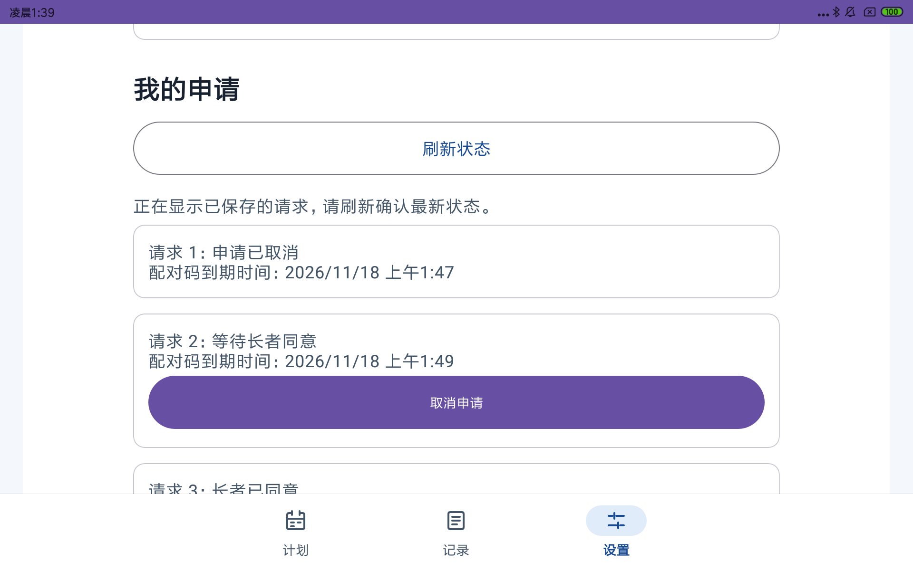
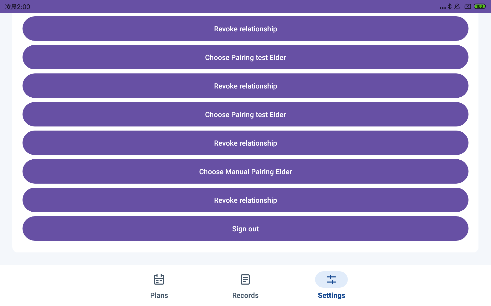
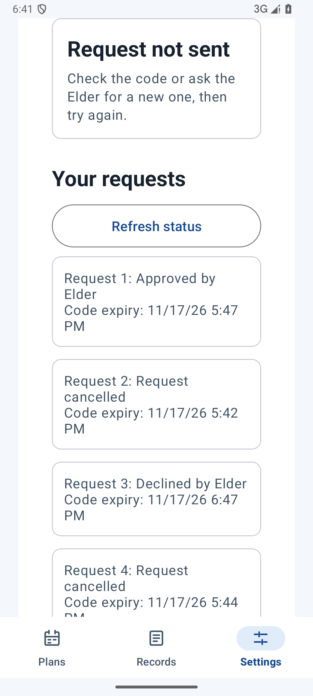
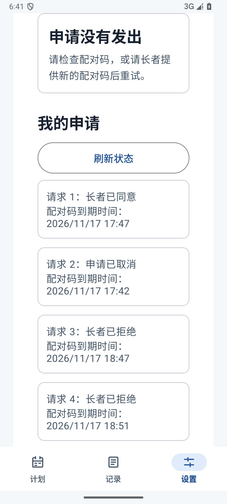
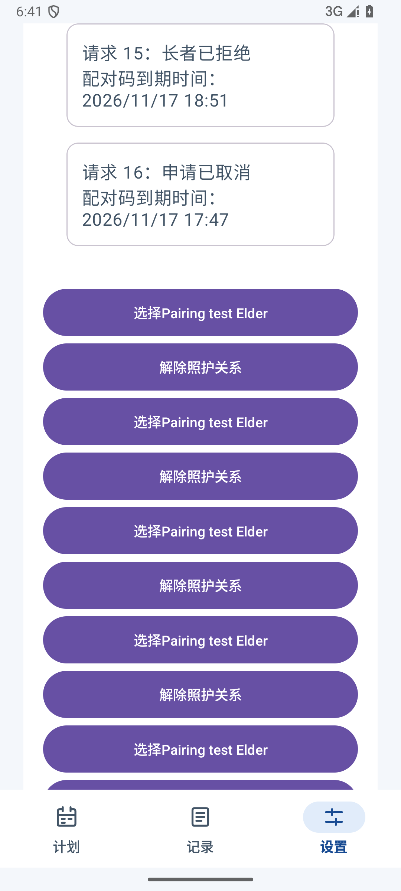

# C1 pairing form integration

## Current main synchronization — 2026-11-17

This integration merges previous PR #112 head
`c6cc08e023532858da49320ee912c057c7bb1e49` with main
`bbe4997034ecb837d2093f4e73267cc530976f29`. Results below are local validation;
current-head CI and non-author review are recorded separately on PR #112.

- The sole textual conflict was the review checksum manifest, regenerated from
  the merged tracked files. The Settings pairing form, current-main caregiver
  dose panel, sign-out cleanup and online-chain test phases are all retained.
- Server and Shared have no changes relative to that main. No new wire contract,
  migration, permission or authentication provider is introduced by this merge.
- Windows/JDK 17: Debug JVM 145/145 and Release JVM 144/144, with zero
  failures/errors/skips. `:android-app:lintDebug`, `:android-app:assembleDebug`,
  `:android-app:assembleRelease` and `:android-app:assembleDebugAndroidTest`
  passed. Lint reports zero errors and 60 warnings. The combined Android command
  completed successfully: 150 tasks, 110 executed and 40 from cache.
- Linux/JDK 17: Server 628/628 and Shared 18/18, with zero failures/errors/skips;
  `:server:bootJar` and `:server:schemaMigrationDist` also passed. The command
  was `./gradlew -PserverOnly test :server:bootJar :server:schemaMigrationDist
  --init-script .gradle/offline-repository.init.gradle --offline --no-daemon
  --max-workers=2 --console=plain` (17 tasks: 16 executed, one up-to-date).
  Online dependency resolution stalled and was stopped; the first offline
  attempts failed before testing because dependency metadata was missing.
  The successful run used already-downloaded artifacts in a temporary local
  Maven repository, added by an external init script. No dependency version,
  tracked repository configuration or test selection was changed. Linux
  Server/Shared/build inputs were hash-compared with the merged source snapshot.
  All three modules' JVM suites passed across these Windows and Linux runs;
  this is not a claim that the unsplit Windows `./gradlew test` succeeded.
- Repository policy (actual PR branch/title), all 446 artifact checksums and
  `git diff --cached --check` passed. No unmerged paths remain. Linux XML reports
  are retained under `/root/.cache/group33-pr112-local-build/`; Android reports
  remain under this worktree's ignored `android-app/build/` directory.
- The API27 screenshots and HTTP/Room flows below are historical evidence.
  No device flow, TalkBack check or manual usability acceptance was rerun for
  this merge. Complete #10/phone authentication acceptance remains outside scope.

The following sections retain the original candidate's history and evidence;
their old branches, baselines and test totals do not identify this merged tree.

## Historical candidate

Refs #10 / PR #112. Owner: `tianiridescent` (C1). Branch:
`feature/10-c1-pairing-main-integration`, based on main `dc1e2fb`.
Scope follows the [lead's recorded direction](https://github.com/BRMRs/group33/pull/112#issuecomment-6686368854).

## Outcome and boundaries

The real caregiver Settings page now hosts the eight-digit form and request history
from #112. It uses the host's authenticated `ChainServices` repositories and retained
ViewModel. The older phone-login/navigation branches and preview repository are not
dependencies. The existing active-Elder selection and plan routes remain the host's
responsibility; a pending or accepted request row cannot itself grant access.

The form keeps leading zeros, reports validation errors beside the field, supports
IME Done, disables duplicate submission, and exposes localized waiting, terminal,
offline, rejected and uncertain-result messages. History distinguishes unknown,
saved/stale and known-empty results. Rows show localized status and code expiry;
only observed pending requests offer cancellation. Both languages use the same
real Settings route, without a second nested scroll container.

All business rows come from `PairingRepository.observeRequests()`. An HTTP result
never inserts a second UI-owned business row. Commands are allocated through
`OnlineCommandRepository.begin()`. Unknown completion and confirmed-but-unreconciled
cache results block another write. Refresh resumes original journal operation IDs
and reads the repository; it never automatically retries rejected/not-submitted
commands. Account/session-generation changes clear the form, cancel outstanding
work, filter foreign history and fence late responses. Observation failures disable
writes and permit an explicit read/observation retry.

No Shared/API/schema, provider authentication, production service registration,
new permissions, or production identity behavior changes. Debug uses the existing
real HTTP/Room anonymous integration; Release retains its existing service boundary.
This slice does not complete all of #10 or phone-provider acceptance.

## Verification

Results below describe local checks, not CI on this unpublished candidate or member
device acceptance. Raw logs/reports are retained outside Git under
`D:/w/review-20261107/` and this worktree's ignored `build/` directories.

- Release JVM suite: 136 tests, zero failures/errors/skips; includes 15 pairing
  ViewModel tests covering validation, Room observation as truth, cancellation,
  original-ID recovery, failure recovery, role/scope checks, observer retry, and
  logout/generation fencing against late responses.
- Shared suite: 18 tests, zero failures/errors/skips.
- Release APK, Server bootJar and schema-migration distribution built successfully.
- Final Debug JVM suite: 136 tests, zero failures/errors/skips. Debug lint: zero
  errors. Debug/Release APKs and Debug instrumentation APK assembled successfully.
- English/Chinese pairing resources: 38 names each, matching sets.
- API 27 Mi Pad 4 Plus: the new opt-in HTTP/UI flow passed in English (8.264 s)
  and Chinese (8.552 s). Both runs submitted a real request, verified no active
  relationship for that Elder before approval, cancelled through the form,
  requested again with a new code, accepted as the test Elder via HTTP, and
  refreshed the active relationship. The existing full two-device harness was
  adjusted and compiled; its full photo/plan sequence was not rerun in this slice.
- `gate1Check test` is **not green locally**: Server ran 627 cases with 310 failures
  on Windows. Failures include unsupported `posix:permissions` and private photo
  storage initialization (`UNAVAILABLE`), cascading into dependent HTTP/plan tests.
  No Server or Shared source differs from the main baseline. Main `dc1e2fb` has a
  [successful Linux CI run](https://github.com/BRMRs/group33/actions/runs/42354462583);
  this does not substitute for CI on the candidate after publication.

The initial offline gate attempt lacked Flyway 11.7.2. A temporary external init
script placed the same Maven Central repository before Google to fill the cache;
no repository dependency version/configuration was changed. The final rebuild
passed the definitive-recovery-failure regression assertion.

The opt-in `PairingFormOnlineTest` exercises submission, no relationship before
approval, cancellation, a second request with a new code, and server approval through
the actual Settings view. Run only against a dedicated local test service:

```text
adb reverse tcp:18082 tcp:18082
gradlew :android-app:assembleDebug :android-app:assembleDebugAndroidTest -PdebugServerUrl=http://127.0.0.1:18082
adb shell am instrument -w -e pairing112 true -e class com.group33.medicationreminder.integration.PairingFormOnlineTest <test-package>/androidx.test.runner.AndroidJUnitRunner
```

The USB API 27 device (`9c69cae2`) remained connected, but the Windows ADB daemon
stopped enumerating it. Restarting ADB restored it without a cable change. The new
APK replaced the old `.review113` preview using `install -r`; no app data was cleared.
The audit application is now this real HTTP/Room integration, rather than the #113
photo/save fixture. Its external audit suffix is not a source application-ID change.

The initial Windows pairing-only Server profile left photo/plan endpoints disabled.
After acceptance, the existing host correctly invalidated authority on a 404 from
those endpoints, making request history unavailable. This was a test-service setup
problem: final device runs used the unchanged Server bootJar on Ubuntu/WSL, with
photo, plan and occurrence modules enabled and a private POSIX photo directory.
A transparent loopback TCP relay connected USB to that service; it changed no HTTP
payloads, statuses or authorization. No client access check was weakened.

APK SHA-256: `1601743b5889fdd700b6b9b6388c9a107320b6aadfd8a3364d584c0b4c61ffab`.
Server bootJar SHA-256: `3feb6c3d37aaffaf7df5616ea63e9402c884951a314292e8a30670b86bd351b7`.
Both run against the source baseline pinned above; this branch changes no Server
source. Device accounts are fictional local-service accounts.


On 2026-11-07, the member manually entered and submitted a fresh fictional Elder
code on the Chinese form. A device screenshot confirmed the pending state. The
test Elder then accepted via HTTP; refreshing showed acceptance, and selecting
C1 manual review Elder showed an active relationship in the host header.
This confirms manual input/submission and the observed pending-to-active result.
Dedicated keyboard, scrolling/Back usability, 200% fonts and TalkBack checks remain
pending. Device offline/unknown-result and account-switch fault injection were not
run; the ViewModel regression suite covers those caller-state protections.

For member review, keep the single visible audit application and its data.
Codex supplies a fresh code from a fictional local Elder and opens Settings.
The member checks: enter/send, see waiting with no new active Elder, then refresh
after the test Elder explicitly approves; inspect Chinese/English text, keyboard,
scrolling and Back. Record actual outcomes before marking device acceptance.

## Publication and review

The member authorized publication after the local checks and manual submission.
PR #112 is updated against main with the integrated form, preserving the original
draft history without a force-push. CI must run on the uploaded head. Keep PR #112
Draft until the recorded Ready criteria are met.
Required non-author Android review and applicable C1/S2 authorization and E
accessibility perspectives follow the team roster.

## 2026-11-18 device rerun on integrated head

Tested source: `a1bf4ab2d5ea05e2ed82f266b5a21a4caa14af5a`, incorporating
main `bbe4997034ecb837d2093f4e73267cc530976f29`. This supersedes the earlier
statement that the main integration had no device rerun; historical evidence
above remains historical. No product source changes were needed for this rerun.

The isolated local-only package was `com.group33.medicationreminder.c1dev112`.
Existing application data and device display/font settings were preserved.
The local Server used in-memory fictional accounts, not production phone identity
or PostgreSQL. Its 150 checked tracked build inputs matched the tested head.
A loopback-only TCP relay and ADB reverse carried unchanged HTTP to WSL.

Build from the existing PR worktree, with JDK17 and Android SDK:

```text
gradlew.bat -I <local-evidence>/device.init.gradle :android-app:assembleDebug :android-app:assembleDebugAndroidTest -PdebugServerUrl=http://127.0.0.1:18082 --offline --no-daemon --max-workers=1 --no-parallel --console=plain
```

The local init script sets only the application ID via
`androidComponents.finalizeDsl`; it is not a product configuration change.
To reproduce without the original local file, create an external Gradle init
script with this content and substitute its path above:

```groovy
allprojects {
    plugins.withId('com.android.application') {
        androidComponents.finalizeDsl { extension ->
            extension.defaultConfig.applicationId = 'com.group33.medicationreminder.c1dev112'
        }
    }
}
```

Both APK builds passed (75 tasks, 26 executed). APK SHA-256:
`09e6d59ba1964be9a2331a0027e94a4d2f3d8cb70f637bc2687476cf0db53d82`.
Test APK SHA-256:
`d654281ab7959181b5bc90a2175985e58b81897d376151bb28dea2442b47e863`.
Server JAR SHA-256:
`860d7cd78e349a51d683b2f3a75d34166cb4217706265eef7977ebdfb68e6773`.

| Device | English | Simplified Chinese |
|---|---|---|
| API35 emulator | PASS | PASS |
| Xiaomi Mi Pad 4 Plus, API27 | PASS | PASS |

Each run executes `PairingFormOnlineTest` with `pairing112=true`: submit through
Settings, observe PENDING with no active relationship for the target Elder,
cancel, issue a new code, resubmit, accept via the fictional Elder HTTP actor,
and refresh until the active relationship reaches the repository cache.
Language is configured with `ChainOnlineFlowTest#configureLanguage`, using
`chainLanguage=en` or `zh-CN`; actual preferences/app locale and visible language
were checked. Four feature flows passed; language setup is not counted as extra
feature coverage. Inputs/clicks in these runs are instrumentation operations.

The first external harness used incorrect language arguments, so its purported
Chinese result remained English and is excluded from bilingual evidence.
Subsequent harness checks also initially assumed the runner left Settings open
and required an offscreen label. The harness was corrected to reopen Settings
and verify the visible language control. Final flows were rerun successfully;
product source and product test assertions were unchanged. Raw attempts remain
in local evidence; they are not represented as clean first-attempt success.




The member confirmed focused-input keyboard visibility, short-code validation,
scrolling to submit and English/Chinese display. The member then manually entered
and sent a fresh eight-digit code. The page showed Request sent; the local Server
confirmed PENDING and an empty relationship list for that Elder. After explicit
HTTP acceptance by the fictional Elder, the member refreshed. Device inspection
showed Request 7: Approved by Elder and Choose Manual Pairing Elder; the Server
acceptance receipt was ACTIVE.




These checks do not complete both actors' normal UI flow, all keyboard/Back
cases, 200% font/TalkBack, device fault injection, phone login, cloud/PostgreSQL,
or the joint photo/plan flow. Existing same-head Linux CI and previous unit/lint
results are referenced, not claimed as rerun here. Overall #10 remains open;
mandatory non-author and specialized reviews remain required.

## 2026-11-18 invalid-code and declined-request regression

Local uncommitted test addition on `4d696c3`:
`PairingFormFailureOnlineTest.invalidatedCodeAndElderRejectionNeverAuthorizeOrAutomaticallyResubmit`.
No product source, protocol or service behavior changes.

On the same dedicated local memory Server and isolated application described
above, API35 ran the test once in English and once in Simplified Chinese, both
PASS. Each execution covers both scenarios:

- Explicitly delete a fictional Elder's code before submitting it via Settings.
  The real journal records REJECTED / PAIRING_CODE_UNAVAILABLE; the localized
  Request not sent notice appears, and no request for that Elder is fabricated.
  Refresh retains the rejected command and allocates no new operation ID.
- Explicitly submit a fresh code, observe PENDING, then reject via the fictional
  Elder HTTP actor. Refresh renders Declined by Elder; a second refresh retains
  the single terminal request and allocates no new operation ID. Authorized
  relationship cache observations contain no ACTIVE relationship for the target.

The final test APK SHA-256 is
`fdf29817ade93958adbe4f79a2b052aa381cebd9d5a18292d750ec834d93c49e`;
the application APK is unchanged from the device rerun above.
Build: `:android-app:assembleDebug :android-app:assembleDebugAndroidTest` using the
same local application-ID init script and debugServerUrl; after test-only edits,
`:android-app:assembleDebugAndroidTest` passed again (57 tasks, 5 executed).
Device runner: `run_failure_device.py emulator-5562 failure-03`, invoking the
same AndroidJUnitRunner with `pairing112=true` and the new test class.






Initial state assertions passed but captured an earlier scroll frame. A capture
helper correction then failed because it cast NestedScrollView to ScrollView;
the actual host type was restored and final bilingual runs passed. Those raw
attempts remain under local evidence `emulator-5562/failure-01`, `failure-02` and
`failure-03`; only failure-03 is final visual evidence. No product assertion was
removed. Screenshots can also contain earlier fictional terminal requests.

The physical tablet was not listed by ADB during this round and was not rerun.
This does not prove ten-minute expiry, rate limiting, offline/unknown-result or
process recovery, real phone identity, or the Elder's normal refusal UI. Earlier
CI applies to committed `4d696c3`, not this uncommitted test addition. No extra
human keyboard acceptance is claimed for these scripted operations.

## 2026-11-18 response loss, offline recovery and process restart

Additional local test source on `4d696c3`, without product code changes:
`PairingResponseLossOnlineTest`, driven by
`scripts/run_c1_pairing_response_loss.py`. The runner validates the APK package
IDs before installation and operates only on `com.group33.medicationreminder.c1dev112`.
It never clears application data. A dedicated fictional-data local Server is
required; production phone identity and remote services are not used.

The loopback fault proxy forwards the original request to the real Server,
records the HTTP result, then closes the client connection without returning
the successful pairing response. It drops every pairing-create response while
armed, including any transport replay. Other traffic is forwarded unchanged.
An offline phase closes connections without contacting the Server. The proxy
audits only SHA-256 hashes of the operation key and body, status and drop flag;
it does not log credentials, original keys or pairing codes.

| Phase | English/API35 | Chinese/API35 | Observed result |
|---|---|---|---|
| `prepareUnknown` | PASS | PASS | Server returned 201 with one PENDING request; client journal AWAITING_CONFIRMATION; duplicate submit disabled |
| `verifyOfflineAfterRestart` | PASS | PASS | Original record restored in a different process; offline refresh retained unknown state and allocated no new operation |
| `recoverOriginalAfterReconnect` | PASS | PASS | Original record became CONFIRMED/APPLIED; original PENDING request restored, no relationship granted or second request created |

The orchestrator force-stops the isolated application before every phase and
checks that its process is gone. Instrumentation also checks that the offline
phase PID differs from the original. Proxy audit confirms exactly two original
operation-key hashes (one per language); dropped attempts and online recovery
share the same key and body hash, and the real Server returns 201 for replay.
The original ADB reverse mapping is restored in a finally block.

Actual reproducible entry point (substitute SDK paths and a fresh evidence folder):

```text
python scripts/run_c1_pairing_response_loss.py --adb <adb.exe> --aapt <aapt.exe> --serial emulator-5562 --output <fresh-evidence-folder>
```

The tested invocation used SDK build-tools 36.0.0, the existing local Server on
127.0.0.1:18082 and output `loss-02` in the existing local evidence directory.
It passed all six phase invocations and its final key/payload audit. The earlier
local prototype `loss-01` also passed all phases but is not counted as additional
scenario coverage. Setup methods are not feature tests.

Build: `:android-app:assembleDebugAndroidTest` with the previously described
isolated-ID init script, `-PdebugServerUrl=http://127.0.0.1:18082 --offline
--no-daemon --max-workers=1 --no-parallel --console=plain`: PASS, 57 tasks,
6 executed. Test APK SHA-256:
`07ef042472a30016ef7654cddc3577aa952b87c0e9f11c089209bd814ac7616f`.
The application APK remains unchanged. Test source SHA-256:
`7e1a98c1221f2d44334fda4f12782a5400fa387dd6c474713686d343a608da12`.

This verifies application-process restart after the unknown result is recorded,
not killing an in-flight command or rebooting the device. Physical-device,
OS-airplane-mode, 401/session-switch races, natural expiry/rate limiting,
production persistence and phone-authenticated flows remain outside this run.
The Elder is an HTTP test actor, not a second normal UI. If a phase fails, retain
its journal and use `--recover-existing` against the same local service to
reconcile the fixture; do not clear application data to make the test pass.

## 2026-11-18 in-flight process death and actual emulator reboot

The existing C1 test and runner now also support `--inflight-reboot`, restricted
to the dedicated `emulator-5562` / `Group33_PR110_C1` AVD. No physical tablet is
rebooted. This extends the previous run's coverage; no product code, shared
contract, journal lease or server behavior is changed.

The proxy receives a real 201 from the Server and holds the response. The test
persists its original command/fixture and signals that the form is still busy.
The runner force-stops the application within eight seconds of the held response,
before the actual ten-second HTTP read timeout. This is a genuinely interrupted
command, not killing an application after it already recorded the transport error.

| Final phase (`inflight-04`) | English/API35 | Chinese/API35 |
|---|---|---|
| `prepareInFlight` | Expected interruption verified | Expected interruption verified |
| `verifyLiveClaimAfterKill` | PASS | PASS |
| Actual emulator boot count | 6 → 7 | 7 → 8 |
| `recoverOriginalAfterReconnect` | PASS | PASS |

The deliberate kill reports Process crashed in instrumentation output. It is
recorded as an expected interruption, never as an ordinary passed test method.
There are four completed assertion methods and two verified interrupted phases.
The same-boot check observes AWAITING_CONFIRMATION, retains the original command,
keeps submit disabled, and forwards no additional pairing POST while the original
claim is live. No real-minute delay or journal/clock mutation bypasses the lease.

After a real reboot, the runner requires sys.boot_completed and an increased
BOOT_COUNT, restores ADB reverse, and waits for the saved app locale. Recovery
then confirms the same operation and applies its cache. Server inspection finds
the original single PENDING request with the same request ID and no relationship.
Proxy audit verifies identical operation-key/body hashes across the held request
and successful replay. Final ADB mapping is restored.

Build: `:android-app:assembleDebugAndroidTest` with the same isolated-ID/server
arguments as above, PASS (57 tasks, 6 executed). Test APK SHA-256:
`d3b1d1ef316cecce48e805340a8987940b79b38f8acb635e87d52689f7439f24`.
Test source SHA-256:
`801e65fdb165d6f9a064fa403a6642883233a997d57b58af2fc9978faa589a07`.
The application APK remains unchanged.

Reproduce with the preceding runner command plus `--inflight-reboot`. The same
final source/APK also reran ordinary response-loss/offline/reconnect phases in
English and Chinese (`loss-03`): all six methods passed, including original
key/body audit. These are regressions, not six additional independent scenarios.

Earlier attempts are retained locally: inflight-01 incorrectly rejected the
temporary absence of a startup PID; inflight-02 attempted to parse a marker not
yet available. The runner now polls both readiness signals. In inflight-03,
English completed, but Chinese exited at an immediate post-boot locale read;
subsequent inspection showed the saved zh-CN locale. Its original command was
reconciled successfully in inflight-03-reconcile without data clearing. The runner
now waits for that same required locale, and inflight-04 completed both languages.
No product assertion or accepted failure evidence was removed.

This is local anonymous-identity/HTTP/in-memory-Server evidence. Physical reboot,
real radio outage, power-loss durability, 401/403/404/session-switch races, natural
lease expiry in the same boot, phone identity and production database acceptance
remain unverified. Full S1 infrastructure and #10/#17 acceptance are not claimed.

## 2026-11-18 current/obsolete 401 and obsolete successful read

Added opt-in `PairingSessionIsolationOnlineTest`, reproduced with:

```text
python scripts/run_c1_pairing_session_isolation.py --adb <adb.exe> --aapt <aapt.exe> --serial emulator-5562 --output <fresh-evidence-folder>
```

Final local output is `isolation-01` in the existing evidence directory. API35
executed all three methods once under English and once under Simplified Chinese:
six method executions, all PASS, representing three scenarios in two language
configurations. The runner verifies isolated APK IDs and actual app locale, never
clears data, and restores the previous ADB reverse mapping.

Each fixture uses a fresh test-only private-session namespace, real anonymous
login, Room command/cache adapters and the existing local HTTP service. It creates
an actual accepted relationship and observed request before testing invalidation.
The C1 PairingWorkflowViewModel is bound to that real fixture repository; these
tests inspect its state, not Activity navigation or translated visible messages.

| Method | Verified behavior |
|---|---|
| `current401ClearsSessionDraftRequestsAndRelationships` | A current-lease 401 clears authentication, trusted scope, draft and request display; request/relationship observations become empty UNKNOWN; no new pairing submission is made |
| `obsolete401CannotSignOutReauthenticatedSession` | A held old 401 arrives after explicit sign-out and reauthentication; replacement generation remains READY, old draft/rows stay cleared, and no extra pairing write occurs |
| `obsoleteSuccessCannotAuthorizeReauthenticatedCache` | A held real old 200 cannot reauthorize request/relationship cache under a replacement generation; only an explicit fresh refresh authorizes current data |

The test transport delegates every request to the real ChainHttp. For the 401
scenarios it deliberately substitutes an invalid credential on exactly one local
pairing-directory read; the real Server returns 401. It does not fabricate an
HTTP reply, new endpoint or server revocation protocol. For obsolete responses,
it holds the already received real 401/200 until after the replacement login,
including through caller cancellation, then returns it to the original caller.

Reauthentication deliberately retains the same anonymous account/scope and
changes the trusted generation. This is not a cross-phone-account test or a
claim that anonymous identity is verified phone identity. No production provider,
PrivateSessionStore, Room schema, Server or product ViewModel changes were needed.

Build: `:android-app:assembleDebugAndroidTest` with the same isolated-ID/local
Server arguments: PASS. The final build after assertion-message edits ran 57
tasks, 5 executed. Test APK SHA-256:
`c3b2e32443ecba080d757c82e59bbd7d39dec28d79913cbee6cbf60142061a12`.
Test source SHA-256:
`3c4817326c07d12402b7468932e20d13b102363026fd797f4355ddf3cd9f3936`.
Application APK SHA-256 remains unchanged from the original isolated build.

Physical-device and login-navigation acceptance, actual JWT expiry/revocation,
cross-phone-account or cross-installation recovery, C2/C3 page/image cleanup,
403/404 and temporary-error behavior remain outside this round. Historical CI
still applies only to committed `4d696c3`; these local additions are uncommitted.

## 2026-11-18 403/404/503 regressions — Xiaomi API27 bilingual PASS

The same isolation class now retains its three prior session cases and adds:

- `forbiddenOperationRetainsSessionAndNeverAutomaticallyReplays`: the Caregiver
  attempts Elder-only code issuance; require a real 403 / ROLE_NOT_ALLOWED, retain
  the common session, and verify resume of the rejection makes no new write.
- `revokedRelationship404ClearsAuthorizationButRetainsSession`: an actual Elder
  revokes an accepted relationship; require the following target-data read to
  return real 404 / RESOURCE_NOT_ACCESSIBLE, remove authorized cache presentation
  and retain the common session.
- `temporaryReadFailureRetainsStaleCacheWithoutClaimingRefreshSuccess`: inject
  the existing contract's 503 / SERVICE_UNAVAILABLE fixture on a directory read;
  require legal authorized cache to remain stale, keep its last-successful time,
  show RefreshFailed state, then recover via an explicit fresh read.
- `temporaryWriteResultRetainsOriginalKeyAndPayloadUntilRecovery`: after real
  Server acceptance, return a synthetic 503 to the client; require unknown journal
  state, no second operation allocation, original key/body hashes on resume, and
  a single real PENDING request without a relationship.

The 503 replies are deliberately synthetic client fault fixtures using existing
ApiError fields/code/status. They are not evidence of a real Server outage. No
service route, DTO, protocol, production registration or product code is added.
The runner now expects seven methods per language and supports the existing
language preference on API23-32, as well as OS per-app locales on API33+.

Device execution completed after the member reconnected/unlocked the Xiaomi
tablet (API27): ENGLISH seven methods PASS, SIMPLIFIED_CHINESE seven methods
PASS, fourteen method executions total. The earlier build-only checkpoint had
no connected device; automatic approval rejected emulator startup with
`blocked by policy`. No alternate launch path was used; these results are from
the tablet, not a restarted emulator.

Completed validation: `:android-app:assembleDebugAndroidTest` with the established
isolated application-ID/local-server arguments, PASS (57 tasks, 6 executed);
runner AST syntax and repository/diff checks. Test source SHA-256:
`b1b418631b3bec2fd9fe6367edc1ec62b11ed01d47e739e7e16dc05a91152d9b`.
Test APK SHA-256:
`f71dd4b38bf1e1a4fb2e1c78ad479cc71fe439a068cf96000c6b8146dd6badf0`.
Previous six-method results refer to the prior source/APK, not this extension.

The previous memory service and relay had also stopped. The identical cached
Server JAR was hash-checked and started as a foreground tracked process with a
new fictional-data memory store/private photo root, then the loopback relay was
restored. This does not preserve prior in-memory fixtures or claim service-restart
recovery; these new tests create their own fresh, private-namespace fixtures.
Executed from the primary workspace:

```text
python ../c1-review-pr112/scripts/run_c1_pairing_session_isolation.py --adb D:/program_self/Android/sdk/platform-tools/adb.exe --aapt D:/program_self/Android/sdk/build-tools/36.0.0/aapt.exe --serial 9c69cae2 --output .git/c1-local-recovery-20261117/pr112-device-20261118/errors-api27-01
```

The retained local result.json matches the source and APK hashes above; both
language logs report `OK (7 tests)`. The runner verified API27 persisted language
preferences and restored the original ADB reverse mapping. Tests observe real
Repository/ViewModel state, not visible navigation or localized error messages.
This does not cover phone-account switching, real service outages, JWT natural
expiry or C2/C3 cache cleanup. No product changes, commit or publication occurred.

## 2026-11-18 pre-publication verification of the uncommitted test increment

With JDK17, the isolated application-ID init script above, local debugServerUrl,
`--offline --no-daemon --max-workers=1 --no-parallel --console=plain`:

- `gradlew.bat test :android-app:lintDebug :android-app:assembleDebug gate1Check`
  failed at `:server:test`: 628 tests, 311 failures, zero errors/skips. Android
  Debug 145 and Release 144 tests completed with zero failures/errors/skips.
  Windows reports include unsupported POSIX attributes and private-photo-store
  initialization failures, plus dependent Spring context failures. This is not
  a green local Gate 1 run. Server source has no changes in this increment;
  the Linux results in the main-synchronization section remain historical.
- A separate `gradlew.bat :android-app:lintDebug :android-app:assembleDebug
  :shared:test` succeeded (56 tasks: 9 executed, 2 from cache, 45 up-to-date).
  Lint: zero errors, 60 warnings. Shared: 18 tests, zero failures/errors/skips,
  restored from cache rather than newly executed.
- `python scripts/check_repository_policy.py`, artifact digest verification
  and `git diff --check` passed. Raw local command logs are retained as
  `prepublish-check-01.log` and `prepublish-android-01.log` in the existing
  ignored evidence directory. Current remote CI covers `4d696c3`, not these
  uncommitted files; the new commit must obtain its own CI result after approval.

Publication scope is three C1 instrumentation classes, two C1 runners, four
failure-state screenshots, this evidence document and the artifact manifest.
No production source, credentials, API/DTO, Server behavior or migration changes.
