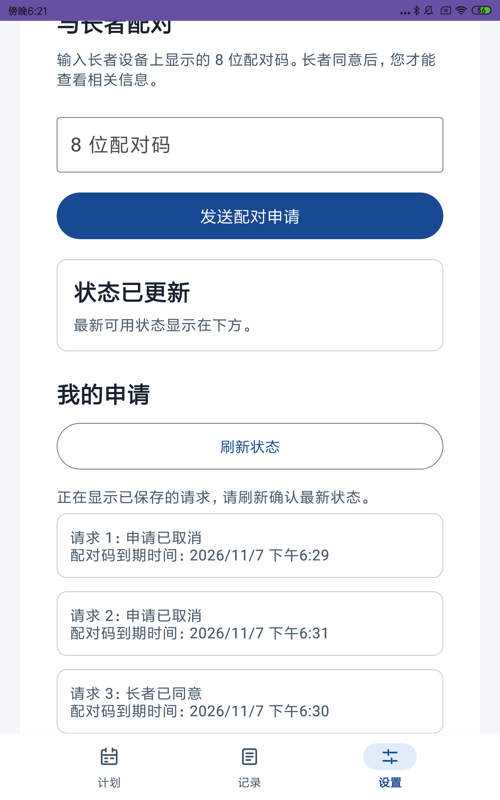
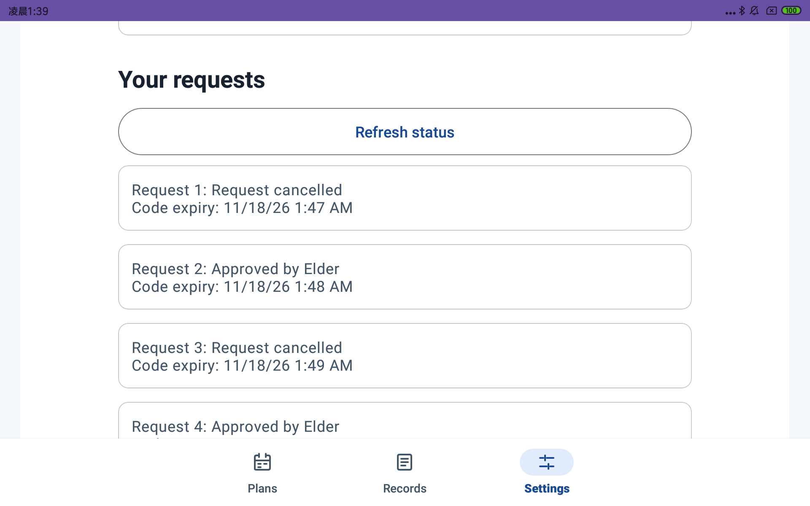
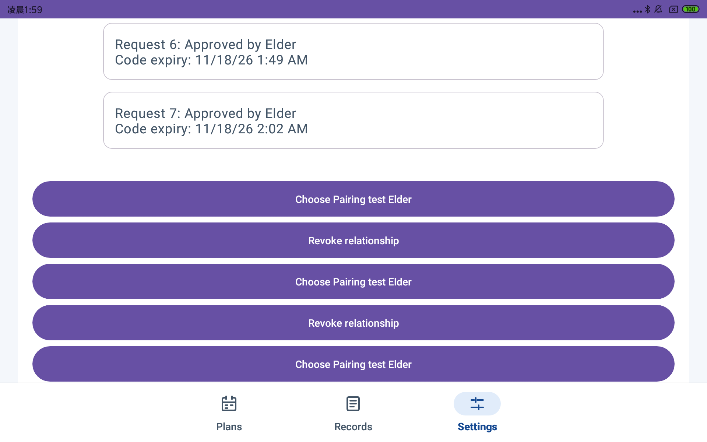
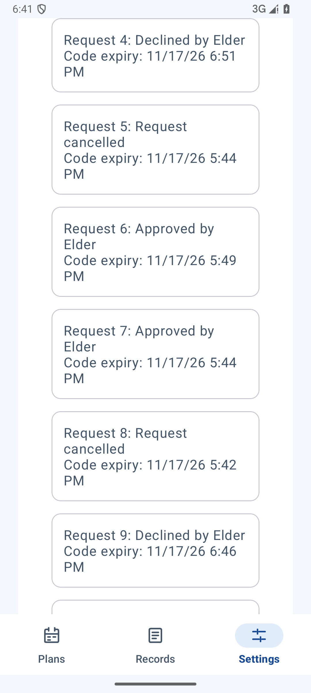

# C1 pairing form integration

## Current main synchronization — 2026-11-17

This integration merges previous PR #112 head
`c6cc08e023532858da49320ee912c057c7bb1e49` with main
`bbe4997034ecb837d2093f4e73267cc530976f29`. Results below are local validation;
current-head CI and non-author review are recorded separately on PR #112.

- The sole textual conflict was the review checksum manifest, regenerated from
  the merged tracked files. The Settings pairing form, current-main caregiver
  dose panel, sign-out cleanup and online-chain test phases are all retained.
- Server and Shared have no changes relative to that main. No new wire contract,
  migration, permission or authentication provider is introduced by this merge.
- Windows/JDK 17: Debug JVM 145/145 and Release JVM 144/144, with zero
  failures/errors/skips. `:android-app:lintDebug`, `:android-app:assembleDebug`,
  `:android-app:assembleRelease` and `:android-app:assembleDebugAndroidTest`
  passed. Lint reports zero errors and 60 warnings. The combined Android command
  completed successfully: 150 tasks, 110 executed and 40 from cache.
- Linux/JDK 17: Server 628/628 and Shared 18/18, with zero failures/errors/skips;
  `:server:bootJar` and `:server:schemaMigrationDist` also passed. The command
  was `./gradlew -PserverOnly test :server:bootJar :server:schemaMigrationDist
  --init-script .gradle/offline-repository.init.gradle --offline --no-daemon
  --max-workers=2 --console=plain` (17 tasks: 16 executed, one up-to-date).
  Online dependency resolution stalled and was stopped; the first offline
  attempts failed before testing because dependency metadata was missing.
  The successful run used already-downloaded artifacts in a temporary local
  Maven repository, added by an external init script. No dependency version,
  tracked repository configuration or test selection was changed. Linux
  Server/Shared/build inputs were hash-compared with the merged source snapshot.
  All three modules' JVM suites passed across these Windows and Linux runs;
  this is not a claim that the unsplit Windows `./gradlew test` succeeded.
- Repository policy (actual PR branch/title), all 446 artifact checksums and
  `git diff --cached --check` passed. No unmerged paths remain. Linux XML reports
  are retained under `/root/.cache/group33-pr112-local-build/`; Android reports
  remain under this worktree's ignored `android-app/build/` directory.
- The API27 screenshots and HTTP/Room flows below are historical evidence.
  No device flow, TalkBack check or manual usability acceptance was rerun for
  this merge. Complete #10/phone authentication acceptance remains outside scope.

The following sections retain the original candidate's history and evidence;
their old branches, baselines and test totals do not identify this merged tree.

## Historical candidate

Refs #10 / PR #112. Owner: `tianiridescent` (C1). Branch:
`feature/10-c1-pairing-main-integration`, based on main `dc1e2fb`.
Scope follows the [lead's recorded direction](https://github.com/BRMRs/group33/pull/112#issuecomment-6686368854).

## Outcome and boundaries

The real caregiver Settings page now hosts the eight-digit form and request history
from #112. It uses the host's authenticated `ChainServices` repositories and retained
ViewModel. The older phone-login/navigation branches and preview repository are not
dependencies. The existing active-Elder selection and plan routes remain the host's
responsibility; a pending or accepted request row cannot itself grant access.

The form keeps leading zeros, reports validation errors beside the field, supports
IME Done, disables duplicate submission, and exposes localized waiting, terminal,
offline, rejected and uncertain-result messages. History distinguishes unknown,
saved/stale and known-empty results. Rows show localized status and code expiry;
only observed pending requests offer cancellation. Both languages use the same
real Settings route, without a second nested scroll container.

All business rows come from `PairingRepository.observeRequests()`. An HTTP result
never inserts a second UI-owned business row. Commands are allocated through
`OnlineCommandRepository.begin()`. Unknown completion and confirmed-but-unreconciled
cache results block another write. Refresh resumes original journal operation IDs
and reads the repository; it never automatically retries rejected/not-submitted
commands. Account/session-generation changes clear the form, cancel outstanding
work, filter foreign history and fence late responses. Observation failures disable
writes and permit an explicit read/observation retry.

No Shared/API/schema, provider authentication, production service registration,
new permissions, or production identity behavior changes. Debug uses the existing
real HTTP/Room anonymous integration; Release retains its existing service boundary.
This slice does not complete all of #10 or phone-provider acceptance.

## Verification

Results below describe local checks, not CI on this unpublished candidate or member
device acceptance. Raw logs/reports are retained outside Git under
`D:/w/review-20261107/` and this worktree's ignored `build/` directories.

- Release JVM suite: 136 tests, zero failures/errors/skips; includes 15 pairing
  ViewModel tests covering validation, Room observation as truth, cancellation,
  original-ID recovery, failure recovery, role/scope checks, observer retry, and
  logout/generation fencing against late responses.
- Shared suite: 18 tests, zero failures/errors/skips.
- Release APK, Server bootJar and schema-migration distribution built successfully.
- Final Debug JVM suite: 136 tests, zero failures/errors/skips. Debug lint: zero
  errors. Debug/Release APKs and Debug instrumentation APK assembled successfully.
- English/Chinese pairing resources: 38 names each, matching sets.
- API 27 Mi Pad 4 Plus: the new opt-in HTTP/UI flow passed in English (8.264 s)
  and Chinese (8.552 s). Both runs submitted a real request, verified no active
  relationship for that Elder before approval, cancelled through the form,
  requested again with a new code, accepted as the test Elder via HTTP, and
  refreshed the active relationship. The existing full two-device harness was
  adjusted and compiled; its full photo/plan sequence was not rerun in this slice.
- `gate1Check test` is **not green locally**: Server ran 627 cases with 310 failures
  on Windows. Failures include unsupported `posix:permissions` and private photo
  storage initialization (`UNAVAILABLE`), cascading into dependent HTTP/plan tests.
  No Server or Shared source differs from the main baseline. Main `dc1e2fb` has a
  [successful Linux CI run](https://github.com/BRMRs/group33/actions/runs/42354462583);
  this does not substitute for CI on the candidate after publication.

The initial offline gate attempt lacked Flyway 11.7.2. A temporary external init
script placed the same Maven Central repository before Google to fill the cache;
no repository dependency version/configuration was changed. The final rebuild
passed the definitive-recovery-failure regression assertion.

The opt-in `PairingFormOnlineTest` exercises submission, no relationship before
approval, cancellation, a second request with a new code, and server approval through
the actual Settings view. Run only against a dedicated local test service:

```text
adb reverse tcp:18082 tcp:18082
gradlew :android-app:assembleDebug :android-app:assembleDebugAndroidTest -PdebugServerUrl=http://127.0.0.1:18082
adb shell am instrument -w -e pairing112 true -e class com.group33.medicationreminder.integration.PairingFormOnlineTest <test-package>/androidx.test.runner.AndroidJUnitRunner
```

The USB API 27 device (`9c69cae2`) remained connected, but the Windows ADB daemon
stopped enumerating it. Restarting ADB restored it without a cable change. The new
APK replaced the old `.review113` preview using `install -r`; no app data was cleared.
The audit application is now this real HTTP/Room integration, rather than the #113
photo/save fixture. Its external audit suffix is not a source application-ID change.

The initial Windows pairing-only Server profile left photo/plan endpoints disabled.
After acceptance, the existing host correctly invalidated authority on a 404 from
those endpoints, making request history unavailable. This was a test-service setup
problem: final device runs used the unchanged Server bootJar on Ubuntu/WSL, with
photo, plan and occurrence modules enabled and a private POSIX photo directory.
A transparent loopback TCP relay connected USB to that service; it changed no HTTP
payloads, statuses or authorization. No client access check was weakened.

APK SHA-256: `1601743b5889fdd700b6b9b6388c9a107320b6aadfd8a3364d584c0b4c61ffab`.
Server bootJar SHA-256: `3feb6c3d37aaffaf7df5616ea63e9402c884951a314292e8a30670b86bd351b7`.
Both run against the source baseline pinned above; this branch changes no Server
source. Device accounts are fictional local-service accounts.




On 2026-11-07, the member manually entered and submitted a fresh fictional Elder
code on the Chinese form. A device screenshot confirmed the pending state. The
test Elder then accepted via HTTP; refreshing showed acceptance, and selecting
C1 manual review Elder showed an active relationship in the host header.
This confirms manual input/submission and the observed pending-to-active result.
Dedicated keyboard, scrolling/Back usability, 200% fonts and TalkBack checks remain
pending. Device offline/unknown-result and account-switch fault injection were not
run; the ViewModel regression suite covers those caller-state protections.

For member review, keep the single visible audit application and its data.
Codex supplies a fresh code from a fictional local Elder and opens Settings.
The member checks: enter/send, see waiting with no new active Elder, then refresh
after the test Elder explicitly approves; inspect Chinese/English text, keyboard,
scrolling and Back. Record actual outcomes before marking device acceptance.

## Publication and review

The member authorized publication after the local checks and manual submission.
PR #112 is updated against main with the integrated form, preserving the original
draft history without a force-push. CI must run on the uploaded head. Keep PR #112
Draft until the recorded Ready criteria are met.
Required non-author Android review and applicable C1/S2 authorization and E
accessibility perspectives follow the team roster.

## 2026-11-18 device rerun on integrated head

Tested source: `a1bf4ab2d5ea05e2ed82f266b5a21a4caa14af5a`, incorporating
main `bbe4997034ecb837d2093f4e73267cc530976f29`. This supersedes the earlier
statement that the main integration had no device rerun; historical evidence
above remains historical. No product source changes were needed for this rerun.

The isolated local-only package was `com.group33.medicationreminder.c1dev112`.
Existing application data and device display/font settings were preserved.
The local Server used in-memory fictional accounts, not production phone identity
or PostgreSQL. Its 150 checked tracked build inputs matched the tested head.
A loopback-only TCP relay and ADB reverse carried unchanged HTTP to WSL.

Build from the existing PR worktree, with JDK17 and Android SDK:

```text
gradlew.bat -I <local-evidence>/device.init.gradle :android-app:assembleDebug :android-app:assembleDebugAndroidTest -PdebugServerUrl=http://127.0.0.1:18082 --offline --no-daemon --max-workers=1 --no-parallel --console=plain
```

The local init script sets only the application ID via
`androidComponents.finalizeDsl`; it is not a product configuration change.
To reproduce without the original local file, create an external Gradle init
script with this content and substitute its path above:

```groovy
allprojects {
    plugins.withId('com.android.application') {
        androidComponents.finalizeDsl { extension ->
            extension.defaultConfig.applicationId = 'com.group33.medicationreminder.c1dev112'
        }
    }
}
```

Both APK builds passed (75 tasks, 26 executed). APK SHA-256:
`09e6d59ba1964be9a2331a0027e94a4d2f3d8cb70f637bc2687476cf0db53d82`.
Test APK SHA-256:
`d654281ab7959181b5bc90a2175985e58b81897d376151bb28dea2442b47e863`.
Server JAR SHA-256:
`860d7cd78e349a51d683b2f3a75d34166cb4217706265eef7977ebdfb68e6773`.

| Device | English | Simplified Chinese |
|---|---|---|
| API35 emulator | PASS | PASS |
| Xiaomi Mi Pad 4 Plus, API27 | PASS | PASS |

Each run executes `PairingFormOnlineTest` with `pairing112=true`: submit through
Settings, observe PENDING with no active relationship for the target Elder,
cancel, issue a new code, resubmit, accept via the fictional Elder HTTP actor,
and refresh until the active relationship reaches the repository cache.
Language is configured with `ChainOnlineFlowTest#configureLanguage`, using
`chainLanguage=en` or `zh-CN`; actual preferences/app locale and visible language
were checked. Four feature flows passed; language setup is not counted as extra
feature coverage. Inputs/clicks in these runs are instrumentation operations.

The first external harness used incorrect language arguments, so its purported
Chinese result remained English and is excluded from bilingual evidence.
Subsequent harness checks also initially assumed the runner left Settings open
and required an offscreen label. The harness was corrected to reopen Settings
and verify the visible language control. Final flows were rerun successfully;
product source and product test assertions were unchanged. Raw attempts remain
in local evidence; they are not represented as clean first-attempt success.




The member confirmed focused-input keyboard visibility, short-code validation,
scrolling to submit and English/Chinese display. The member then manually entered
and sent a fresh eight-digit code. The page showed Request sent; the local Server
confirmed PENDING and an empty relationship list for that Elder. After explicit
HTTP acceptance by the fictional Elder, the member refreshed. Device inspection
showed Request 7: Approved by Elder and Choose Manual Pairing Elder; the Server
acceptance receipt was ACTIVE.




These checks do not complete both actors' normal UI flow, all keyboard/Back
cases, 200% font/TalkBack, device fault injection, phone login, cloud/PostgreSQL,
or the joint photo/plan flow. Existing same-head Linux CI and previous unit/lint
results are referenced, not claimed as rerun here. Overall #10 remains open;
mandatory non-author and specialized reviews remain required.

## 2026-11-18 invalid-code and declined-request regression

Local uncommitted test addition on `4d696c3`:
`PairingFormFailureOnlineTest.invalidatedCodeAndElderRejectionNeverAuthorizeOrAutomaticallyResubmit`.
No product source, protocol or service behavior changes.

On the same dedicated local memory Server and isolated application described
above, API35 ran the test once in English and once in Simplified Chinese, both
PASS. Each execution covers both scenarios:

- Explicitly delete a fictional Elder's code before submitting it via Settings.
  The real journal records REJECTED / PAIRING_CODE_UNAVAILABLE; the localized
  Request not sent notice appears, and no request for that Elder is fabricated.
  Refresh retains the rejected command and allocates no new operation ID.
- Explicitly submit a fresh code, observe PENDING, then reject via the fictional
  Elder HTTP actor. Refresh renders Declined by Elder; a second refresh retains
  the single terminal request and allocates no new operation ID. Authorized
  relationship cache observations contain no ACTIVE relationship for the target.

The final test APK SHA-256 is
`fdf29817ade93958adbe4f79a2b052aa381cebd9d5a18292d750ec834d93c49e`;
the application APK is unchanged from the device rerun above.
Build: `:android-app:assembleDebug :android-app:assembleDebugAndroidTest` using the
same local application-ID init script and debugServerUrl; after test-only edits,
`:android-app:assembleDebugAndroidTest` passed again (57 tasks, 5 executed).
Device runner: `run_failure_device.py emulator-5562 failure-03`, invoking the
same AndroidJUnitRunner with `pairing112=true` and the new test class.





Initial state assertions passed but captured an earlier scroll frame. A capture
helper correction then failed because it cast NestedScrollView to ScrollView;
the actual host type was restored and final bilingual runs passed. Those raw
attempts remain under local evidence `emulator-5562/failure-01`, `failure-02` and
`failure-03`; only failure-03 is final visual evidence. No product assertion was
removed. Screenshots can also contain earlier fictional terminal requests.

The physical tablet was not listed by ADB during this round and was not rerun.
This does not prove ten-minute expiry, rate limiting, offline/unknown-result or
process recovery, real phone identity, or the Elder's normal refusal UI. Earlier
CI applies to committed `4d696c3`, not this uncommitted test addition. No extra
human keyboard acceptance is claimed for these scripted operations.

## 2026-11-18 response loss, offline recovery and process restart

Additional local test source on `4d696c3`, without product code changes:
`PairingResponseLossOnlineTest`, driven by
`scripts/run_c1_pairing_response_loss.py`. The runner validates the APK package
IDs before installation and operates only on `com.group33.medicationreminder.c1dev112`.
It never clears application data. A dedicated fictional-data local Server is
required; production phone identity and remote services are not used.

The loopback fault proxy forwards the original request to the real Server,
records the HTTP result, then closes the client connection without returning
the successful pairing response. It drops every pairing-create response while
armed, including any transport replay. Other traffic is forwarded unchanged.
An offline phase closes connections without contacting the Server. The proxy
audits only SHA-256 hashes of the operation key and body, status and drop flag;
it does not log credentials, original keys or pairing codes.

| Phase | English/API35 | Chinese/API35 | Observed result |
|---|---|---|---|
| `prepareUnknown` | PASS | PASS | Server returned 201 with one PENDING request; client journal AWAITING_CONFIRMATION; duplicate submit disabled |
| `verifyOfflineAfterRestart` | PASS | PASS | Original record restored in a different process; offline refresh retained unknown state and allocated no new operation |
| `recoverOriginalAfterReconnect` | PASS | PASS | Original record became CONFIRMED/APPLIED; original PENDING request restored, no relationship granted or second request created |

The orchestrator force-stops the isolated application before every phase and
checks that its process is gone. Instrumentation also checks that the offline
phase PID differs from the original. Proxy audit confirms exactly two original
operation-key hashes (one per language); dropped attempts and online recovery
share the same key and body hash, and the real Server returns 201 for replay.
The original ADB reverse mapping is restored in a finally block.

Actual reproducible entry point (substitute SDK paths and a fresh evidence folder):

```text
python scripts/run_c1_pairing_response_loss.py --adb <adb.exe> --aapt <aapt.exe> --serial emulator-5562 --output <fresh-evidence-folder>
```

The tested invocation used SDK build-tools 36.0.0, the existing local Server on
127.0.0.1:18082 and output `loss-02` in the existing local evidence directory.
It passed all six phase invocations and its final key/payload audit. The earlier
local prototype `loss-01` also passed all phases but is not counted as additional
scenario coverage. Setup methods are not feature tests.

Build: `:android-app:assembleDebugAndroidTest` with the previously described
isolated-ID init script, `-PdebugServerUrl=http://127.0.0.1:18082 --offline
--no-daemon --max-workers=1 --no-parallel --console=plain`: PASS, 57 tasks,
6 executed. Test APK SHA-256:
`07ef042472a30016ef7654cddc3577aa952b87c0e9f11c089209bd814ac7616f`.
The application APK remains unchanged. Test source SHA-256:
`7e1a98c1221f2d44334fda4f12782a5400fa387dd6c474713686d343a608da12`.

This verifies application-process restart after the unknown result is recorded,
not killing an in-flight command or rebooting the device. Physical-device,
OS-airplane-mode, 401/session-switch races, natural expiry/rate limiting,
production persistence and phone-authenticated flows remain outside this run.
The Elder is an HTTP test actor, not a second normal UI. If a phase fails, retain
its journal and use `--recover-existing` against the same local service to
reconcile the fixture; do not clear application data to make the test pass.

## 2026-11-18 in-flight process death and actual emulator reboot

The existing C1 test and runner now also support `--inflight-reboot`, restricted
to the dedicated `emulator-5562` / `Group33_PR110_C1` AVD. No physical tablet is
rebooted. This extends the previous run's coverage; no product code, shared
contract, journal lease or server behavior is changed.

The proxy receives a real 201 from the Server and holds the response. The test
persists its original command/fixture and signals that the form is still busy.
The runner force-stops the application within eight seconds of the held response,
before the actual ten-second HTTP read timeout. This is a genuinely interrupted
command, not killing an application after it already recorded the transport error.

| Final phase (`inflight-04`) | English/API35 | Chinese/API35 |
|---|---|---|
| `prepareInFlight` | Expected interruption verified | Expected interruption verified |
| `verifyLiveClaimAfterKill` | PASS | PASS |
| Actual emulator boot count | 6 → 7 | 7 → 8 |
| `recoverOriginalAfterReconnect` | PASS | PASS |

The deliberate kill reports Process crashed in instrumentation output. It is
recorded as an expected interruption, never as an ordinary passed test method.
There are four completed assertion methods and two verified interrupted phases.
The same-boot check observes AWAITING_CONFIRMATION, retains the original command,
keeps submit disabled, and forwards no additional pairing POST while the original
claim is live. No real-minute delay or journal/clock mutation bypasses the lease.

After a real reboot, the runner requires sys.boot_completed and an increased
BOOT_COUNT, restores ADB reverse, and waits for the saved app locale. Recovery
then confirms the same operation and applies its cache. Server inspection finds
the original single PENDING request with the same request ID and no relationship.
Proxy audit verifies identical operation-key/body hashes across the held request
and successful replay. Final ADB mapping is restored.

Build: `:android-app:assembleDebugAndroidTest` with the same isolated-ID/server
arguments as above, PASS (57 tasks, 6 executed). Test APK SHA-256:
`d3b1d1ef316cecce48e805340a8987940b79b38f8acb635e87d52689f7439f24`.
Test source SHA-256:
`801e65fdb165d6f9a064fa403a6642883233a997d57b58af2fc9978faa589a07`.
The application APK remains unchanged.

Reproduce with the preceding runner command plus `--inflight-reboot`. The same
final source/APK also reran ordinary response-loss/offline/reconnect phases in
English and Chinese (`loss-03`): all six methods passed, including original
key/body audit. These are regressions, not six additional independent scenarios.

Earlier attempts are retained locally: inflight-01 incorrectly rejected the
temporary absence of a startup PID; inflight-02 attempted to parse a marker not
yet available. The runner now polls both readiness signals. In inflight-03,
English completed, but Chinese exited at an immediate post-boot locale read;
subsequent inspection showed the saved zh-CN locale. Its original command was
reconciled successfully in inflight-03-reconcile without data clearing. The runner
now waits for that same required locale, and inflight-04 completed both languages.
No product assertion or accepted failure evidence was removed.

This is local anonymous-identity/HTTP/in-memory-Server evidence. Physical reboot,
real radio outage, power-loss durability, 401/403/404/session-switch races, natural
lease expiry in the same boot, phone identity and production database acceptance
remain unverified. Full S1 infrastructure and #10/#17 acceptance are not claimed.

## 2026-11-18 current/obsolete 401 and obsolete successful read

Added opt-in `PairingSessionIsolationOnlineTest`, reproduced with:

```text
python scripts/run_c1_pairing_session_isolation.py --adb <adb.exe> --aapt <aapt.exe> --serial emulator-5562 --output <fresh-evidence-folder>
```

Final local output is `isolation-01` in the existing evidence directory. API35
executed all three methods once under English and once under Simplified Chinese:
six method executions, all PASS, representing three scenarios in two language
configurations. The runner verifies isolated APK IDs and actual app locale, never
clears data, and restores the previous ADB reverse mapping.

Each fixture uses a fresh test-only private-session namespace, real anonymous
login, Room command/cache adapters and the existing local HTTP service. It creates
an actual accepted relationship and observed request before testing invalidation.
The C1 PairingWorkflowViewModel is bound to that real fixture repository; these
tests inspect its state, not Activity navigation or translated visible messages.

| Method | Verified behavior |
|---|---|
| `current401ClearsSessionDraftRequestsAndRelationships` | A current-lease 401 clears authentication, trusted scope, draft and request display; request/relationship observations become empty UNKNOWN; no new pairing submission is made |
| `obsolete401CannotSignOutReauthenticatedSession` | A held old 401 arrives after explicit sign-out and reauthentication; replacement generation remains READY, old draft/rows stay cleared, and no extra pairing write occurs |
| `obsoleteSuccessCannotAuthorizeReauthenticatedCache` | A held real old 200 cannot reauthorize request/relationship cache under a replacement generation; only an explicit fresh refresh authorizes current data |

The test transport delegates every request to the real ChainHttp. For the 401
scenarios it deliberately substitutes an invalid credential on exactly one local
pairing-directory read; the real Server returns 401. It does not fabricate an
HTTP reply, new endpoint or server revocation protocol. For obsolete responses,
it holds the already received real 401/200 until after the replacement login,
including through caller cancellation, then returns it to the original caller.

Reauthentication deliberately retains the same anonymous account/scope and
changes the trusted generation. This is not a cross-phone-account test or a
claim that anonymous identity is verified phone identity. No production provider,
PrivateSessionStore, Room schema, Server or product ViewModel changes were needed.

Build: `:android-app:assembleDebugAndroidTest` with the same isolated-ID/local
Server arguments: PASS. The final build after assertion-message edits ran 57
tasks, 5 executed. Test APK SHA-256:
`c3b2e32443ecba080d757c82e59bbd7d39dec28d79913cbee6cbf60142061a12`.
Test source SHA-256:
`3c4817326c07d12402b7468932e20d13b102363026fd797f4355ddf3cd9f3936`.
Application APK SHA-256 remains unchanged from the original isolated build.

Physical-device and login-navigation acceptance, actual JWT expiry/revocation,
cross-phone-account or cross-installation recovery, C2/C3 page/image cleanup,
403/404 and temporary-error behavior remain outside this round. Historical CI
still applies only to committed `4d696c3`; these local additions are uncommitted.

## 2026-11-18 403/404/503 regressions — Xiaomi API27 bilingual PASS

The same isolation class now retains its three prior session cases and adds:

- `forbiddenOperationRetainsSessionAndNeverAutomaticallyReplays`: the Caregiver
  attempts Elder-only code issuance; require a real 403 / ROLE_NOT_ALLOWED, retain
  the common session, and verify resume of the rejection makes no new write.
- `revokedRelationship404ClearsAuthorizationButRetainsSession`: an actual Elder
  revokes an accepted relationship; require the following target-data read to
  return real 404 / RESOURCE_NOT_ACCESSIBLE, remove authorized cache presentation
  and retain the common session.
- `temporaryReadFailureRetainsStaleCacheWithoutClaimingRefreshSuccess`: inject
  the existing contract's 503 / SERVICE_UNAVAILABLE fixture on a directory read;
  require legal authorized cache to remain stale, keep its last-successful time,
  show RefreshFailed state, then recover via an explicit fresh read.
- `temporaryWriteResultRetainsOriginalKeyAndPayloadUntilRecovery`: after real
  Server acceptance, return a synthetic 503 to the client; require unknown journal
  state, no second operation allocation, original key/body hashes on resume, and
  a single real PENDING request without a relationship.

The 503 replies are deliberately synthetic client fault fixtures using existing
ApiError fields/code/status. They are not evidence of a real Server outage. No
service route, DTO, protocol, production registration or product code is added.
The runner now expects seven methods per language and supports the existing
language preference on API23-32, as well as OS per-app locales on API33+.

Device execution completed after the member reconnected/unlocked the Xiaomi
tablet (API27): ENGLISH seven methods PASS, SIMPLIFIED_CHINESE seven methods
PASS, fourteen method executions total. The earlier build-only checkpoint had
no connected device; automatic approval rejected emulator startup with
`blocked by policy`. No alternate launch path was used; these results are from
the tablet, not a restarted emulator.

Completed validation: `:android-app:assembleDebugAndroidTest` with the established
isolated application-ID/local-server arguments, PASS (57 tasks, 6 executed);
runner AST syntax and repository/diff checks. Test source SHA-256:
`b1b418631b3bec2fd9fe6367edc1ec62b11ed01d47e739e7e16dc05a91152d9b`.
Test APK SHA-256:
`f71dd4b38bf1e1a4fb2e1c78ad479cc71fe439a068cf96000c6b8146dd6badf0`.
Previous six-method results refer to the prior source/APK, not this extension.

The previous memory service and relay had also stopped. The identical cached
Server JAR was hash-checked and started as a foreground tracked process with a
new fictional-data memory store/private photo root, then the loopback relay was
restored. This does not preserve prior in-memory fixtures or claim service-restart
recovery; these new tests create their own fresh, private-namespace fixtures.
Executed from the primary workspace:

```text
python ../c1-review-pr112/scripts/run_c1_pairing_session_isolation.py --adb D:/program_self/Android/sdk/platform-tools/adb.exe --aapt D:/program_self/Android/sdk/build-tools/36.0.0/aapt.exe --serial 9c69cae2 --output .git/c1-local-recovery-20261117/pr112-device-20261118/errors-api27-01
```

The retained local result.json matches the source and APK hashes above; both
language logs report `OK (7 tests)`. The runner verified API27 persisted language
preferences and restored the original ADB reverse mapping. Tests observe real
Repository/ViewModel state, not visible navigation or localized error messages.
This does not cover phone-account switching, real service outages, JWT natural
expiry or C2/C3 cache cleanup. No product changes, commit or publication occurred.

## 2026-11-18 pre-publication verification of the uncommitted test increment

With JDK17, the isolated application-ID init script above, local debugServerUrl,
`--offline --no-daemon --max-workers=1 --no-parallel --console=plain`:

- `gradlew.bat test :android-app:lintDebug :android-app:assembleDebug gate1Check`
  failed at `:server:test`: 628 tests, 311 failures, zero errors/skips. Android
  Debug 145 and Release 144 tests completed with zero failures/errors/skips.
  Windows reports include unsupported POSIX attributes and private-photo-store
  initialization failures, plus dependent Spring context failures. This is not
  a green local Gate 1 run. Server source has no changes in this increment;
  the Linux results in the main-synchronization section remain historical.
- A separate `gradlew.bat :android-app:lintDebug :android-app:assembleDebug
  :shared:test` succeeded (56 tasks: 9 executed, 2 from cache, 45 up-to-date).
  Lint: zero errors, 60 warnings. Shared: 18 tests, zero failures/errors/skips,
  restored from cache rather than newly executed.
- `python scripts/check_repository_policy.py`, artifact digest verification
  and `git diff --check` passed. Raw local command logs are retained as
  `prepublish-check-01.log` and `prepublish-android-01.log` in the existing
  ignored evidence directory. Current remote CI covers `4d696c3`, not these
  uncommitted files; the new commit must obtain its own CI result after approval.

Publication scope is three C1 instrumentation classes, two C1 runners, four
failure-state screenshots, this evidence document and the artifact manifest.
No production source, credentials, API/DTO, Server behavior or migration changes.

## 2026-11-18 multi-Elder host regression — local, not yet published

Base: `1f3642fdd6c34d7a3009bbdd19185e83435abed7`; remote main remains
`bbe4997034ecb837d2093f4e73267cc530976f29`. Added three focused tests to
`ChainViewModelTest` using its existing Repository test doubles:

- Multiple authorized Elders require explicit selection; A → B → A presents
  only the selected Elder's photos and clears the previous photo retry target.
  Selection submits no business command.
- Revoking selected A leaves B available but does not silently select B;
  a new relationship for A also requires explicit selection, and the revoked ID
  cannot reactivate A.
- While relationship access is UNKNOWN, selecting B or emitting its photo cache
  cannot authorize the host. Data appears only after authorized relationships
  are observed again.

Executed on Windows/JDK17 from the PR worktree:

```text
gradlew.bat :android-app:testDebugUnitTest :android-app:testReleaseUnitTest --tests com.group33.medicationreminder.integration.ChainViewModelTest --tests com.group33.medicationreminder.core.data.contract.CaregiverContextResolverTest --offline --no-daemon --max-workers=1 --no-parallel --console=plain
```

PASS, 1m52s, 63 tasks. Each variant ran 18 host + 3 resolver tests, zero
failures/errors/skips (42 executions across the two variants, not 42 distinct
scenarios). Raw local log: `multi-elder-jvm-01.log` in the existing ignored
evidence directory. This is deterministic JVM host evidence, not real HTTP,
Room, visible bilingual pages, C2/C3 cleanup or phone identity verification.
ADB listed no device, so multi-Elder device/manual acceptance is pending.
No product source or protocol changes; no commit/push/publication for this increment.

## 2026-11-18 multi-Elder real HTTP/Room and Activity regression — API27 PASS

Added opt-in `PairingMultiElderOnlineTest`. English and Simplified Chinese each
passed its one method on Xiaomi API27. Fresh fictional Elder actors issue codes
and accept through real HTTP; the installed Caregiver uses its real Repository,
Room, Activity and localized choice buttons. Each run explicitly chooses A → B → A,
asserts the header name and unchanged command IDs, revokes A through the real
Repository, verifies A's choice disappears without automatic B selection, and
explicitly chooses still-active B. There are no seeded photos, plans or drafts;
empty photo state is not evidence of populated C2/C3 cache cleanup.

Build with the isolated init script above: `:android-app:assembleDebug
:android-app:assembleDebugAndroidTest` and the established local-server/offline
arguments, PASS (48s, 75 tasks). Test source SHA-256:
`10b415778a48e1343ddff6f3d4f459c975870a0055634ea4fca63966a83c4344`.
Test APK SHA-256:
`1bc985c416b1053a04533200d1b1fe5985e821435c94a9cc9456d4851a7188a8`.
App APK retains `09e6d59ba1964be9a2331a0027e94a4d2f3d8cb70f637bc2687476cf0db53d82`.

Reproduce after installing the isolated APKs, configuring each language using
`ChainOnlineFlowTest#configureLanguage` with `chainLanguage=en` or `zh-CN`, and
setting device reverse tcp:18082 to the loopback fictional-data service:

```text
adb -s <serial> shell am instrument -w -r -e class com.group33.medicationreminder.integration.PairingMultiElderOnlineTest -e pairingMultiElder true com.group33.medicationreminder.c1dev112.test/androidx.test.runner.AndroidJUnitRunner
```

Only the final Chinese run adds `-e keepManualElders true`, creating one fresh
Elder/relationship for manual selection (not the revoked Elder's re-pairing).
The two runs total five pairing requests; repeated runs must respect the existing
Server rate limits. Local result/logs: `multi-api27-01`, produced by the ignored
runner adapted from the existing session-isolation runner with this class and
one expected method per language. Both language preferences and APK identities
were verified. The service had stopped and was restarted with the same cached
JAR/new memory fixtures; no old in-memory recovery is claimed.

Runner restored its original ADB mapping. For manual acceptance a new loopback
reverse was then explicitly enabled, the exported SharedLoginActivity opened,
and Settings scrolled to the choices. Direct shell launch of the private role
Activity was denied by Android; the normal exported entry routed successfully.
`multi-elder-ready-zh-api27-20261118.png` records preparation only. Current manual
targets are `C1 Elder A new 070ad5` and `C1 Elder B 070ad5`; the older English
fixture `C1 Elder B de4aca` is also legitimate and can be ignored for this check.
Manual touch/header/navigation/revoke acceptance remains pending member feedback.
No production changes, commit, push or GitHub publication for this increment.

## 2026-11-18 relationship button feedback — local, device acceptance pending

The member confirmed selection/navigation/revocation worked, but reported no
noticeable button feedback. Relationship rows previously rebuilt on every state
render, interrupting pressed/ripple state. `OnlineFeatureContent` now retains
those rows until the active relationship list changes, labels the current choice
in English/Chinese, and uses a nearby Snackbar for selection and revoke progress
and result. This is a C1 interaction fix, not the later overall visual redesign.

Validation from the existing PR worktree, Windows/JDK17, isolated application ID
and `-PdebugServerUrl=http://127.0.0.1:18082`:

```text
gradlew.bat -I <existing-device.init.gradle> :android-app:testDebugUnitTest :android-app:testReleaseUnitTest :android-app:assembleDebug :android-app:assembleDebugAndroidTest :android-app:lintDebug --offline --no-daemon --max-workers=1 --no-parallel --console=plain
```

PASS, 4m16s, 122 tasks: Debug 148 and Release 147 tests, zero failures/errors/skips;
lint zero errors and 60 warnings. Raw log: `multi-feedback-build-01.log` in the
existing ignored evidence directory. Instrumentation now checks retained button
identity, localized selected labels and an actually visible revoke result after
clicking the revoke UI button. Test-only rebuilds `multi-feedback-build-02.log`
and `-03.log` passed (38s/52s, 57 tasks each).

Device attempts `multi-feedback-api27-01` / `-02` failed locating a choice;
`-03` explicitly waited for a rendered choice and timed out. Subsequent device
inspection found the lock screen foreground and `isStatusBarKeyguard=true`,
`showing=true`; the Activity cannot provide foreground rendering acceptance in
that state. These attempts are failures, not feedback acceptance. The test also
now handles both the selected and unselected localized button text and waits for
the Snackbar to be visibly rendered. Re-run both languages with the tablet
unlocked, then obtain member touch-feedback acceptance and bilingual screenshots.
No new device-pass or manual-feedback-pass claim; no commit/push/publication.

### Unlocked-device rerun — API27 bilingual feedback PASS

After the member unlocked the tablet, `dumpsys window policy` reported
`isStatusBarKeyguard=false` and `showing=false`. Ran the same opt-in runner:

```text
python .git/c1-local-recovery-20261117/pr112-device-20261118/run_multi_elders.py --adb D:/program_self/Android/sdk/platform-tools/adb.exe --aapt D:/program_self/Android/sdk/build-tools/36.0.0/aapt.exe --serial 9c69cae2 --output .git/c1-local-recovery-20261117/pr112-device-20261118/multi-feedback-api27-04
```

English and Simplified Chinese each passed one method. This includes A/B/A
selection with the same button instances, localized selected text, real UI
revocation with a visible localized Snackbar result, and no automatic selection
of B after A is revoked. The preceding three failed attempts remain recorded;
they are not counted as passes. Member feedback before this fix confirmed the
functional selection/navigation/revocation flow; the new tactile/visual feedback
still requires member acceptance.

The base HEAD is `1f3642f`; these are uncommitted working-tree changes, not the
remote CI-tested version. Exact rerun SHA-256 values:

- Instrumentation source: `fd25fc60732045f841657d64ae194a6d0aaf2e06b79ccf8f5c85c06c269de43b`.
- App APK: `180a0fde46d9a101b796a856d26567b5ed4e0f939cb959e9a059791f804eb55a`.
- Test APK: `30c58a5260ddc16254601b76766d25b43a609dbcd95574a9c554c8dba15f88f2`.

Visible screenshots (fictional fixtures, inspected in both languages):

- [English selected button and feedback](c1-pairing-main/multi-elder-feedback-en-api27-20261118.png).
- [Chinese selected button and feedback](c1-pairing-main/multi-elder-feedback-zh-api27-20261118.png).

The normal exported entry was used after each language setup. Chinese Settings
is left showing selected `C1 Elder A new 9c5954` and available `C1 Elder B 9c5954`
for member acceptance; older fictional fixtures remain untouched. The local
loopback reverse remains enabled for this manual check. Screenshots show the
selected label and Snackbar, not a recorded finger press or a TalkBack audit.

No API, authorization, identity, Server or persistence behavior was changed.
These fictional anonymous Debug actors do not prove phone-login integration,
populated C2/C3 data cleanup or real Elder-side consent UI. No commit, push or
GitHub publication for this increment.

Member acceptance after the unlocked-device rerun: the member reported normal
functionality and additionally revoked some other test relationships. The local
fixture inventory may therefore differ from the preparation screenshots; those
screenshots remain historical evidence. The reported remaining concern is the
overall visual design, scheduled for the shared frontend finish after the three
functional workstreams. This report accepts the requested interaction feedback;
it is not a complete accessibility or C2/C3 integration sign-off. No publication
approval has been given for this increment.

## 2026-11-18 pairing state boundaries — local JVM increment

Base `47cc919cdc1d65f4584eaa3b4dc5340f3214f74f`. Added four tests to the existing
`PairingWorkflowViewModelTest`, using its Repository/command test doubles:

- Every observed terminal status (ACCEPTED, REJECTED, CANCELLED, EXPIRED) survives
  refresh; cancel and refresh create no replacement request or command.
- An explicitly NOT_SUBMITTED/OFFLINE result retains the entered code, creates
  no observed pending row, and a failed offline refresh never resubmits it.
- An unresolved command carrying RETRY_LATER stays unknown; another submit is
  blocked, and explicit reconciliation uses the same original operation until
  confirmation. The test does not simulate HTTP 429 headers or waiting behavior.
- An unknown cancellation blocks a second cancellation and reconciles the same
  cancellation operation; observed CANCELLED remains terminal.

Executed from the existing PR worktree on Windows/JDK17:

```text
gradlew.bat :android-app:testDebugUnitTest :android-app:testReleaseUnitTest --tests com.group33.medicationreminder.caregiver.PairingWorkflowViewModelTest --offline --no-daemon --max-workers=1 --no-parallel --console=plain
```

PASS, 1m25s, 63 tasks. Each variant ran 19 tests, zero failures/errors/skips
(38 executions, including the four new cases twice). Raw local command log:
`pairing-states-jvm-01.log` in the existing ignored evidence directory.

No product, API, Server, identity, UI or timing-rule changes. API_CONTRACT T04
already specifies server-controlled ten-minute expiry, terminal consumption and
rate limits. Server tests with injected clocks already exist, but were not run
in this increment and are not claimed as new evidence. Client fake-state tests
cannot prove real expiry, real rate limiting, Retry-After enforcement, HTTP/Room
integration or visible bilingual prompts. ADB currently lists no device; continue
real-device form/error acceptance when connected. No new manual-acceptance claim,
commit, push or publication for this increment.

### Connected Xiaomi API27 form regression and deterministic Server rules

The tablet was reconnected/unlocked. Rebuilt isolated Debug and androidTest APKs
with the existing init script and `-PdebugServerUrl=http://127.0.0.1:18082`:
`:android-app:assembleDebug :android-app:assembleDebugAndroidTest --offline
--no-daemon --max-workers=1 --no-parallel --console=plain`, PASS, 54s/75 tasks.

Ran the existing `PairingFormFailureOnlineTest` on API27, English and Simplified
Chinese, one method each, both PASS. This is real HTTP/Room, command journal,
Settings Activity, localized rejection notice and request row. It verifies
invalidated-code rejection, a subsequent fresh-code request, Elder rejection via
HTTP, no target active relationship, and refresh without resubmission. It does
not drive the normal Elder consent UI. The local ignored runner is adapted from
the existing device runner and preserves earlier outputs and ADB mappings:

```text
python .git/c1-local-recovery-20261117/pr112-device-20261118/run_form_failure.py --adb D:/program_self/Android/sdk/platform-tools/adb.exe --aapt D:/program_self/Android/sdk/build-tools/36.0.0/aapt.exe --serial 9c69cae2 --output .git/c1-local-recovery-20261117/pr112-device-20261118/form-api27-01
```

Recorded SHA-256:

- Form instrumentation source: `d58d2484e5ad670addee2f9af38fc002bf2f990ac9919627876f18bb18e4da7a`.
- App APK: `180a0fde46d9a101b796a856d26567b5ed4e0f939cb959e9a059791f804eb55a`.
- Test APK: `30c58a5260ddc16254601b76766d25b43a609dbcd95574a9c554c8dba15f88f2`.

Inspected screenshots (landscape is the member's current device orientation):

- [English invalidated code](c1-pairing-main/form-invalidated-en-api27-20261118.png).
- [Chinese invalidated code](c1-pairing-main/form-invalidated-zh-api27-20261118.png).
- [English declined request](c1-pairing-main/form-rejected-en-api27-20261118.png).
- [Chinese declined request after refresh](c1-pairing-main/form-rejected-zh-api27-20261118.png).

The English after-refresh screenshot clipped the declined row's status at the
top despite the test's geometric visibility check. It remains in raw local
outputs, not used as visible status evidence; the retained English declined
screenshot does show the status. The explicit row/status and no-resubmission
assertions passed after refresh in both languages. No product fix or weakened
assertion was introduced to hide that screenshot limitation.

Also executed existing Server service tests on the same source worktree,
Windows/JDK17, with injectable clocks/in-memory stores:

```text
gradlew.bat -PserverOnly :server:test --tests com.group33.server.pairing.PairingCodeIssuanceServiceTest --tests com.group33.server.pairing.PairingRequestServiceTest --tests com.group33.server.pairing.PairingDecisionServiceTest --offline --no-daemon --max-workers=1 --no-parallel --console=plain
```

PASS: issuance 17, requests 32, decisions 35, total 84 tests, zero
failures/errors/skips. These include deadline-minus-one/exact/plus-one boundaries,
expiry without renewal on replay, consumption/renewal, installation/IP limits
and recovery, and decision/cancellation/revocation ordering. Raw local log:
`pairing-states-server-01.log`. No Server files were changed. This targeted pass
does not supersede the previously documented Windows full-suite failures, and
is not PostgreSQL, production deployment or HTTP Retry-After evidence.

For member acceptance, reopened the normal exported login entry, navigated to
Chinese Settings and scrolled to `请求 11：长者已拒绝`. Its raw code expiry label
is historical metadata, not active authorization. Local loopback reverse remains
enabled for manual refresh. Member checks should confirm readable declined status,
no cancel action for that terminal request, and refresh does not turn it pending.
Real HTTP 429/Retry-After client end-to-end acceptance remains outstanding; no
manual acceptance or publication is claimed for this increment.

Member acceptance follow-up: the member manually verified both requested checks
on the tablet: the declined request is readable with no cancellation action,
and an explicit refresh leaves it declined. This accepts those two form checks,
not the outstanding HTTP429/Retry-After, phone identity or complete accessibility
scope. No upload approval has been given for this increment.

### Real HTTP429 client test preparation — not yet device-verified

Added `PairingRateLimitOnlineTest`, opt-in `pairingRateLimit=true`. It uses a
fresh private Debug session namespace and a genuinely issued-then-invalidated
code. Five rejected requests exhaust that installation's allowance; the next
request must return real HTTP429/RETRY_LATER with Retry-After. No reply status,
body or header is fabricated. The test holds the client's requested wait,
checks duplicate begin is blocked, then releases it and explicitly reconciles
the same operation. The second response is still genuinely rate-limited; it
compares operation/body digests, unchanged journal identities, session retention
and absence of invented requests/relationships.

`DebugChainRepository` adds an optional suspend waiting function, defaulting to
the existing `delay`, at the existing 429/5xx backoff point. Existing delay
calculation and default runtime behavior remain unchanged. Only this test
supplies a controlled wait, so no real minute is spent sleeping. This can verify
that the actual header drives the requested wait and blocks completion until
released; it does not prove real elapsed sleeping or successful post-window
recovery. Server controlled-clock tests separately cover quota-window recovery.
There is no new UI or production identity/session binding decision.

The tablet disconnected after the member's form acceptance. ADB then listed only
an unrelated emulator; it was not used. Build/regression results and the real
device result must be recorded before claiming this new test passed. This
prepared test is not additional human acceptance or publication approval.

Build/regression completed successfully on Windows/JDK17: the isolated init
script, `-PdebugServerUrl=http://127.0.0.1:18082`, offline/no-daemon/one-worker
arguments and tasks `:android-app:assembleDebug :android-app:assembleDebugAndroidTest
:android-app:testDebugUnitTest :android-app:testReleaseUnitTest :android-app:lintDebug`.
Result: 8m24s, 122 tasks; Debug 152 and Release 151 tests, zero failures/errors/skips;
lint zero errors and 60 warnings. Raw log: `pairing-rate-build-01.log` in the
existing ignored evidence directory. New instrumentation compiles but has not
run on the tablet; only the unrelated emulator remains visible in ADB.

### Real HTTP429 client/Room regression — Xiaomi API27 PASS

The member reconnected/unlocked the Xiaomi tablet and requested waiting until
another PR's device test finished. Read-only inspection found its instrumentation
client still running; after it exited, a further check found no active
instrumentation/UI-driving process. Only then did this run install the isolated
c1dev112 packages. The unrelated emulator was not used.

```text
python .git/c1-local-recovery-20261117/pr112-device-20261118/run_rate_limit.py --adb D:/program_self/Android/sdk/platform-tools/adb.exe --aapt D:/program_self/Android/sdk/build-tools/36.0.0/aapt.exe --serial 9c69cae2 --output .git/c1-local-recovery-20261117/pr112-device-20261118/rate-api27-01
```

PASS, one opt-in method, Chinese app preference verified; this is a Repository
and Room assertion test, not evidence of a visible Chinese or English rate-limit
page. The first five genuine submissions returned 422 for the invalidated code;
the sixth and explicit reconciliation returned actual HTTP429/RETRY_LATER and
Retry-After. The wait callback received the actual header in milliseconds,
held completion while a duplicate begin was rejected, and released explicitly.
Both rate-limited sends retained the same operation/body digests; six journal
identities remained unchanged, the session stayed trusted and no request or
relationship was invented. The injected callback does not prove elapsed wall
time or success after the quota window expires. Existing controlled-clock
Server tests prove the separate window-recovery behavior.

Exact SHA-256 values from the runner:

- Instrumentation source: `9c9b5ecd36766db28a815195a6052675faa7b15aabb4def0fd2f64e05e443fde`.
- App APK: `d2635e39a40bff69c2136c0256ee428aeda03a3931c505228784037b5e8f07bd`.
- Test APK: `a64761d2359fd4a9330a6aa653161cc5c587421c503356733a81143af29a98d9`.

Runner restored the prior ADB reverse mapping. The base remains `47cc919`; this
new test and wait seam are uncommitted and not covered by that remote commit's
CI. There is no new user-facing behavior to accept manually in this rate-limit
increment; the member's previous form acceptance remains valid. Phone identity,
normal two-party UI, overall accessibility and populated C2/C3 cleanup are still
separate acceptance scope. No commit/push/publication for this increment.

## 2026-11-18 populated photo/editor isolation — prepared, device pending

After the preceding nine-file increment was approved and published as `593068f`,
started the next work-plan item on that base. Remote main is still `bbe4997`;
C2/C3 candidate PRs #111/#120/#122 remain open. This test targets only the current
C1 host and the already-present plan editor, not unmerged candidate pages.

Extended the existing `PairingMultiElderOnlineTest` with an independently opt-in
method `switchingAndRevokingClearPopulatedPhotoAndPlanDraft`, requiring
`pairingPopulatedIsolation=true`. The original multi-Elder method keeps its
original opt-in and photo-free fixtures. The new fixture generates solid-color
32x24 PNGs locally (no real photos), uploads through existing Elder HTTP, and
creates real consent/relationships through the existing HTTP endpoints. On the
Caregiver side it will open actual photos/editor, type unsaved fictional drafts,
switch A→B→A and revoke A through UI. Assertions require hidden/cleared image and
fields after context changes, blank draft when reopening either Elder, no auto
B selection after revocation and no newly submitted plan command. Earlier plan
commands, if any, are compared rather than requiring a clean app database.

Code inspection found that the host clears the visible editor but retains
per-photo ViewModels in the Activity store; whether an old draft reappears must
be tested before declaring a defect or changing behavior. No product fix has
been made in this increment and no C2/C3 contract is being guessed.

The isolated `:android-app:assembleDebugAndroidTest` build passed on Windows/JDK17,
offline/no-daemon/one-worker, with the existing init script and local URL:
1m11s, 57 tasks. Raw log: `populated-isolation-build-01.log` in the ignored
evidence directory. The tablet is listed `offline`; the unrelated emulator and
another review's device process were not taken over. The new method has not run,
so neither populated editor cleanup nor draft reappearance is claimed verified.
No new manual acceptance, commit, push or publication for this increment.

Environment follow-up: host-loopback preflight created an independent fictional
Elder and uploaded a generated 32x24 blue PNG through the existing photo endpoint,
receiving 201 for login and upload. The first temporary script attempt sent a raw
PNG instead of the existing multipart format and failed; after inspecting
`ChainHttp`/the controller, the script used the same `file` multipart field and
passed. This was a script correction, not a product/API change. Local metadata:
`photo-isolation-preflight-01.json` in the existing ignored directory; credentials
were held only in memory and not written to logs or evidence. This preflight
does not prove Android decoding, authorization isolation or editor cleanup.

ADB showed the Xiaomi missing/offline. With no active ADB instrumentation,
installation, reboot or UI-driving client detected, only its transport was
reconnected; the shared ADB server and other emulator were left running. The
tablet then appeared `unauthorized`, requiring the member to allow USB debugging.
The populated-isolation method is still unexecuted pending that authorization.

### USB authorized: reproduced draft retention and local fix

After USB authorization, `populated-api27-01` ran the new opt-in method on the
Xiaomi API27 against the existing local HTTP service. English failed when
returning A→B→A: the reopened A editor contained `Draft C1 photo Elder A ...`
instead of an empty name. Chinese did not run after this failure. The failure
and APK/source hashes are retained in that ignored directory; this is a real
product-state failure, not a missing-device result.

The C1 host now retains editor ViewModels in `CaregiverEditorModels`, an
Activity-retained holder with a separate ViewModelStore. It discards that store
when account/environment/installation, session generation, relationship or
Elder changes, or authorized context disappears. A display-name change and
ordinary navigation within the same authorized context retain the draft.
Activity destruction clears the nested store through the holder lifecycle;
configuration changes retain it. This does not change C2's editor implementation,
wire contracts, repository registration or persisted command/journal records.
An unknown submitted command is not deleted or assigned a new key by this fix.

Added four JVM regressions for scope identity, switch-back, same-context retention
and holder lifecycle. The real-device method additionally checks that ordinary
Records→Plans navigation retains the current draft, while context changes clear
the photo and editable fields. Generated images and fictional names only.
The local fix is not uploaded; build/device rerun results follow when complete.

Reproduction commands (JDK17, Android SDK, local service on 18082):

```text
./gradlew :android-app:testDebugUnitTest :android-app:testReleaseUnitTest :android-app:lintDebug :android-app:assembleDebug :android-app:assembleDebugAndroidTest -I <existing-isolated-package-init.gradle> -PdebugServerUrl=http://127.0.0.1:18082 --offline --no-daemon --max-workers=1 --no-parallel --console=plain
adb -s 9c69cae2 shell am instrument -w -r -e class com.group33.medicationreminder.integration.PairingMultiElderOnlineTest#switchingAndRevokingClearPopulatedPhotoAndPlanDraft -e pairingPopulatedIsolation true -e keepManualElders true com.group33.medicationreminder.c1dev112.test/androidx.test.runner.AndroidJUnitRunner
```

The optional `keepManualElders` fixture creates a replacement consenting fictional
Elder with a generated photo after assertions, leaving two active choices for
manual acceptance. It does not restore the revoked relationship. The local
runner sets and verifies each app language, installs only the isolated packages,
records APK/source hashes and restores the prior ADB reverse mapping.

### 2026-11-19 non-device checks

`populated-isolation-fix-build-01.log`: the combined command above completed
successfully (122 tasks, 37 executed). Android Debug **156** and Release **155**
tests each have zero failures/errors/skips; these include all four new holder
regressions. Lint reports **0 errors / 47 warnings**. Both isolated Debug APKs
built. The run crossed a long tool/session interruption; Gradle reported 2h2m39s
elapsed, so this is not a normal build-duration measurement.

`./gradlew test` with the same init/local URL/offline/one-worker arguments was
also actually rerun: **FAILED**, Server **628 / 311 failed** (1m30s, 71 tasks).
Reports include unsupported `Files.setPosixFilePermissions` on Windows, private
photo-store initialization failures and dependent Spring context failures.
This matches the previously recorded Windows failure category; Server sources
were not changed. The full command is not recorded as green. Raw log:
`populated-isolation-full-test-01.log` in the existing ignored directory.

Repository policy passes. The repaired app has **not** run on the tablet: it is
not available and the member requested postponing device tests. Preserve the
earlier failing `populated-api27-01` separately; do not describe it as a post-fix
pass. English/Chinese device regression, screenshots and the member's manual
acceptance remain outstanding before upload approval. No commit, push or
GitHub publication for this slice.

A Linux follow-up used the existing WSL build cache, with **153** Server/Shared,
Gradle and fixture files compared to this worktree (line endings normalized;
zero mismatches). No new checkout or source tree was created. The initial
wrapper invocation lacked executable permission (exit 126); invoking it through
`bash` reached Gradle, but `:server:test :shared:test -PserverOnly --offline
--rerun-tasks` failed dependency resolution because required artifacts were not
available to that offline repository context. Neither attempt ran tests or
counts as a Linux pass. Logs: `populated-linux-server-test-01/02.log`. Linux CI
must still verify the eventual approved commit; no tests or source protections
were disabled to hide the Windows failure.

### 2026-11-19 Xiaomi post-fix regression and manual handoff

The Xiaomi returned authorized/unlocked. Before installation, the recorded hashes
of all changed source files and both APKs matched `populated-local-checks-01.json`.
PR #112 remote head was still `593068f`; these product changes remain local.

```text
python .git/c1-local-recovery-20261117/pr112-device-20261118/run_populated_isolation.py --adb D:/program_self/Android/sdk/platform-tools/adb.exe --aapt D:/program_self/Android/sdk/build-tools/36.0.0/aapt.exe --serial 9c69cae2 --output .git/c1-local-recovery-20261117/pr112-device-20261118/populated-api27-02
python .git/c1-local-recovery-20261117/pr112-device-20261118/run_populated_isolation.py --adb D:/program_self/Android/sdk/platform-tools/adb.exe --aapt D:/program_self/Android/sdk/build-tools/36.0.0/aapt.exe --serial 9c69cae2 --languages SIMPLIFIED_CHINESE --output .git/c1-local-recovery-20261117/pr112-device-20261118/populated-api27-03
```

- **02 English: PASS**, one opt-in method, 19.654 seconds.
- **02 Chinese: FAIL** at `pair()`'s confirmation assertion during fixture setup.
  No detailed HTTP result was recorded, so the precise cause is unconfirmed.
  The original runner prepared three relationships in each language; six inputs
  on one installation can exceed the existing five/minute quota. This was a
  diagnostic hypothesis, not a recorded HTTP429 result. The failure is retained.
- The runner now prepares the optional manual replacement only for the last
  selected language (five requests for a complete two-language run), and allows
  an explicit single-language run. It changes no service quota or device clock.
- After using the existing UI's explicit pending-submission check,
  **03 Chinese: PASS**, one opt-in method. Same test source/app APK/test APK as
  English; no product or instrumentation source changes between these runs.

Both passing methods assert actual decoded fictional photos and editable
drafts, A→B→A cleanup, ordinary Records→Plans retention within A, revocation
clearing the image/editor/collections without selecting B automatically, and no
new CONFIRM_PLAN command. Language preferences were independently verified.
Provider consent is still HTTP fixture setup, not normal Elder UI acceptance.

Inspected evidence: [English fresh editor](c1-pairing-main/populated-fresh-en-api27.png)
and [Chinese fresh editor](c1-pairing-main/populated-fresh-zh-api27.png). Both show
the fictional blue photo, Elder label and empty medication-name field; the
dosage field is below the screenshot viewport and is covered by assertions.
The action-status text retains the earlier revoke message in these captures;
the authoritative active context and subsequent ordinary display were checked
separately. No overall visual/accessibility acceptance is claimed.

During manual preparation, re-launch showed no selected Elder and misleadingly
said there were no active relationships. A transparent local diagnostic relay
observed successful collection reads (200; 29 requests/26 relationships, logging
only status/counts). Scrolling Settings exposed the existing choices; selecting
`C1 photo Elder B 0f2ad9` restored its active header and photo entry. This was not
lost relationship data. The wording defect is recorded as a separate work-plan
follow-up, not silently treated as fixed by this editor-store change. The
diagnostic relay was stopped and ADB reverse restored to direct local port18082
for manual acceptance. Attempts to start the non-exported home directly were
denied as expected; the normal exported login entry was used instead. No app
export/permission settings or original app data were changed.

Manual acceptance is pending: B and `C1 photo Elder A new 0f2ad9` have generated
photos. Enter an unsaved draft, switch away/back and reopen: blank; ordinary
Records→Plans within the same selection: retained; revoke the selected relation:
old photo/editor cleared and the other Elder remains explicitly selectable.
Do not save a plan for these checks. No commit, push or publication yet.

### Dropdown follow-up requested by the member

The member found the stacked selection/actions and the three-step acceptance
confusing; the preceding manual handoff was not accepted. Updated the work plan
before changing this scope. C1 now presents one fixed, read-only Material dropdown
above the scrolling content. Only active relationships from the current trusted
account are listed, newest first; a captured lease and current membership are
rechecked when an item is selected. Relationship/session updates dismiss stale
menus. No keyboard input, implicit first-item selection or new transport fields.

Settings manages only the selected relationship, before the pairing form/history;
it no longer repeats selection/revoke controls for every Elder. Existing logout,
pairing and explicit command recovery remain. The host distinguishes an available
choice from no active relationships, and a new selection clears previous action
feedback without deleting its command. The editor-scope fix remains in place.
No C2/C3 editor, accepted identity/API contract or production registration changes.

The existing real-service tests now open the actual popup and click adapter items,
checking current context, single selected relationship action, removal of revoked
options, unchanged command identities, draft/image cleanup and same-context
navigation retention. Added a ViewModel regression for clearing old feedback while
preserving its original target/command; the unavailable navigation UI checks the
selector is disabled and non-editable. New build/device results must be recorded
below: the preceding text-button results do not prove this new dropdown UI.

#### Final dropdown checks

`dropdown-build-02.log`: final product-source build passed (5m30s, 122 tasks),
Android Debug **157** / Release **156**, zero failures/errors/skips. Lint reports
**0 errors / 49 warnings**. Both isolated APKs built. The first build was an
intermediate iteration; the second includes the final caregiver-only ordering,
newest-first options and API23-compatible padding. No Elder screen is reordered.

`dropdown-navigation-api27-01`: **3/3 PASS**, API27 (5.612s). Command:

```text
adb -s 9c69cae2 shell am instrument -w -r -e class com.group33.medicationreminder.caregiver.CaregiverNavigationUiTest com.group33.medicationreminder.c1dev112.test/androidx.test.runner.AndroidJUnitRunner
```

`dropdown-api27-01`: English/Chinese methods passed, but visual inspection found
the screenshots caught the frame before the menu/editor finished drawing. Those
captures remain in the ignored run directory and are not published as dropdown
or visible-editor evidence. Strengthened the instrumentation to assert a visible
popup item, wait for accessibility idle, and require the complete name field
inside the scrolling viewport above navigation before capture. Product sources
did not change. `dropdown-build-03.log` rebuilt AndroidTest and lint successfully
(2m42s, 66 tasks; product tasks up-to-date).

```text
./gradlew :android-app:testDebugUnitTest :android-app:testReleaseUnitTest :android-app:lintDebug :android-app:assembleDebug :android-app:assembleDebugAndroidTest -I <existing-isolated-package-init.gradle> -PdebugServerUrl=http://127.0.0.1:18082 --offline --no-daemon --max-workers=1 --no-parallel --console=plain
./gradlew :android-app:lintDebug :android-app:assembleDebugAndroidTest -I <existing-isolated-package-init.gradle> -PdebugServerUrl=http://127.0.0.1:18082 --offline --no-daemon --max-workers=1 --no-parallel --console=plain
python .git/c1-local-recovery-20261117/pr112-device-20261118/run_populated_isolation.py --adb D:/program_self/Android/sdk/platform-tools/adb.exe --aapt D:/program_self/Android/sdk/build-tools/36.0.0/aapt.exe --serial 9c69cae2 --output .git/c1-local-recovery-20261117/pr112-device-20261118/dropdown-api27-02
```

Final **dropdown-api27-02 English/Chinese: PASS**, one actual popup-selection
method per language, including A→B→A, visible cleared name field/photo ownership,
same-context Records→Plans retention, revoke cleanup/no implicit selection and
no new plan command. Five pairing fixtures total; only the last language creates
the manual replacement. No real-minute wait, quota/clock change or data reset.
Navigation used the same product APK; only the populated-test class changed for
the later screenshot checks. Raw result JSON records per-run source/APK hashes:

- Product APK: `cb450c99fb69790d6b1d1a60c12b432b147a39a9859379dfff41eeadcf038adc`.
- Final test APK: `f207c268ab5c44205f6fb821103f0eead028f52c64f126daa862ec7bd2d4eb0d`.
- Populated test source: `9936bf650da062dd4ba3ef340eb63f71116c4e6be763d86e2c2ace13430c72a0`.

Inspected [English dropdown](c1-pairing-main/dropdown-en-api27.png),
[Chinese dropdown](c1-pairing-main/dropdown-zh-api27.png),
[English cleared editor](c1-pairing-main/dropdown-editor-en-api27.png) and
[Chinese cleared editor](c1-pairing-main/dropdown-editor-zh-api27.png).
The fixed selection remains visible while the editor scrolls. The long names
are accumulated fictional test accounts, not hardcoded production choices;
account display names are not translated when the app language changes.

Manual acceptance is now a single usability flow: use the top dropdown to choose
another fictional Elder and confirm the entry/selection feels clear. The prior
three-step manual request is replaced by the automated coverage above, not marked
as human-passed. Full C2/C3 composition, small-screen/200%-font/TalkBack acceptance,
phone identity and normal two-party Elder UI remain separate. Earlier Windows
Server failures/Linux offline-resolution limits are unchanged; Server tests were
not rerun for these Android-only UI edits. No commit/push/publication for this
unaccepted local slice.

### Human usability acceptance — 2026-11-19

The C1 owner confirmed the dropdown selection and current functionality work on
the Xiaomi tablet. The earlier complex manual flow is superseded by this
usability acceptance plus the automated isolation/revocation coverage above.
This is not approval to publish or a teammate PR approval. Remaining visual
polish is deferred until all three C1 functional tracks are complete; final
C2/C3 composition and accessibility checks remain outstanding as listed above.
