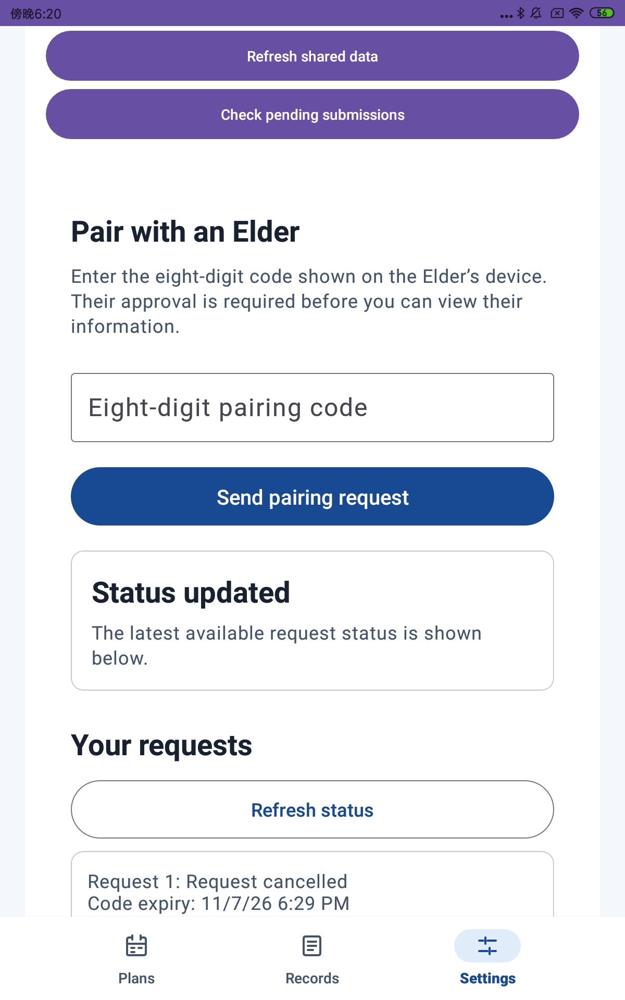
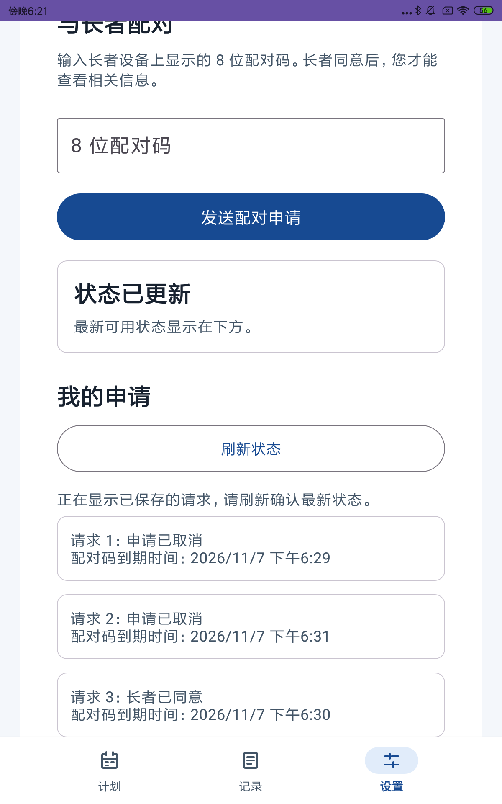

# C1 pairing form integration — local candidate

Refs #10 / PR #112. Owner: `tianiridescent` (C1). Branch:
`feature/10-c1-pairing-main-integration`, based on main `dc1e2fb`.
Scope follows the [lead's recorded direction](https://github.com/BRMRs/group33/pull/112#issuecomment-6686368854).

## Outcome and boundaries

The real caregiver Settings page now hosts the eight-digit form and request history
from #112. It uses the host's authenticated `ChainServices` repositories and retained
ViewModel. The older phone-login/navigation branches and preview repository are not
dependencies. The existing active-Elder selection and plan routes remain the host's
responsibility; a pending or accepted request row cannot itself grant access.

The form keeps leading zeros, reports validation errors beside the field, supports
IME Done, disables duplicate submission, and exposes localized waiting, terminal,
offline, rejected and uncertain-result messages. History distinguishes unknown,
saved/stale and known-empty results. Rows show localized status and code expiry;
only observed pending requests offer cancellation. Both languages use the same
real Settings route, without a second nested scroll container.

All business rows come from `PairingRepository.observeRequests()`. An HTTP result
never inserts a second UI-owned business row. Commands are allocated through
`OnlineCommandRepository.begin()`. Unknown completion and confirmed-but-unreconciled
cache results block another write. Refresh resumes original journal operation IDs
and reads the repository; it never automatically retries rejected/not-submitted
commands. Account/session-generation changes clear the form, cancel outstanding
work, filter foreign history and fence late responses. Observation failures disable
writes and permit an explicit read/observation retry.

No Shared/API/schema, provider authentication, production service registration,
new permissions, or production identity behavior changes. Debug uses the existing
real HTTP/Room anonymous integration; Release retains its existing service boundary.
This slice does not complete all of #10 or phone-provider acceptance.

## Verification

Results below describe local checks, not CI on this unpublished candidate or member
device acceptance. Raw logs/reports are retained outside Git under
`D:/w/review-20261107/` and this worktree's ignored `build/` directories.

- Release JVM suite: 136 tests, zero failures/errors/skips; includes 15 pairing
  ViewModel tests covering validation, Room observation as truth, cancellation,
  original-ID recovery, failure recovery, role/scope checks, observer retry, and
  logout/generation fencing against late responses.
- Shared suite: 18 tests, zero failures/errors/skips.
- Release APK, Server bootJar and schema-migration distribution built successfully.
- Final Debug JVM suite: 136 tests, zero failures/errors/skips. Debug lint: zero
  errors. Debug/Release APKs and Debug instrumentation APK assembled successfully.
- English/Chinese pairing resources: 38 names each, matching sets.
- API 27 Mi Pad 4 Plus: the new opt-in HTTP/UI flow passed in English (8.264 s)
  and Chinese (8.552 s). Both runs submitted a real request, verified no active
  relationship for that Elder before approval, cancelled through the form,
  requested again with a new code, accepted as the test Elder via HTTP, and
  refreshed the active relationship. The existing full two-device harness was
  adjusted and compiled; its full photo/plan sequence was not rerun in this slice.
- `gate1Check test` is **not green locally**: Server ran 627 cases with 310 failures
  on Windows. Failures include unsupported `posix:permissions` and private photo
  storage initialization (`UNAVAILABLE`), cascading into dependent HTTP/plan tests.
  No Server or Shared source differs from the main baseline. Main `dc1e2fb` has a
  [successful Linux CI run](https://github.com/BRMRs/group33/actions/runs/42354462583);
  this does not substitute for CI on the candidate after publication.

The initial offline gate attempt lacked Flyway 11.7.2. A temporary external init
script placed the same Maven Central repository before Google to fill the cache;
no repository dependency version/configuration was changed. The final rebuild
passed the definitive-recovery-failure regression assertion.

The opt-in `PairingFormOnlineTest` exercises submission, no relationship before
approval, cancellation, a second request with a new code, and server approval through
the actual Settings view. Run only against a dedicated local test service:

```text
adb reverse tcp:18082 tcp:18082
gradlew :android-app:assembleDebug :android-app:assembleDebugAndroidTest -PdebugServerUrl=http://127.0.0.1:18082
adb shell am instrument -w -e pairing112 true -e class com.group33.medicationreminder.integration.PairingFormOnlineTest <test-package>/androidx.test.runner.AndroidJUnitRunner
```

The USB API 27 device (`9c69cae2`) remained connected, but the Windows ADB daemon
stopped enumerating it. Restarting ADB restored it without a cable change. The new
APK replaced the old `.review113` preview using `install -r`; no app data was cleared.
The audit application is now this real HTTP/Room integration, rather than the #113
photo/save fixture. Its external audit suffix is not a source application-ID change.

The initial Windows pairing-only Server profile left photo/plan endpoints disabled.
After acceptance, the existing host correctly invalidated authority on a 404 from
those endpoints, making request history unavailable. This was a test-service setup
problem: final device runs used the unchanged Server bootJar on Ubuntu/WSL, with
photo, plan and occurrence modules enabled and a private POSIX photo directory.
A transparent loopback TCP relay connected USB to that service; it changed no HTTP
payloads, statuses or authorization. No client access check was weakened.

APK SHA-256: `1601743b5889fdd700b6b9b6388c9a107320b6aadfd8a3364d584c0b4c61ffab`.
Server bootJar SHA-256: `3feb6c3d37aaffaf7df5616ea63e9402c884951a314292e8a30670b86bd351b7`.
Both run against the source baseline pinned above; this branch changes no Server
source. Device accounts are fictional local-service accounts.




On 2026-11-07, the member manually entered and submitted a fresh fictional Elder
code on the Chinese form. A device screenshot confirmed the pending state. The
test Elder then accepted via HTTP; refreshing showed acceptance, and selecting
C1 manual review Elder showed an active relationship in the host header.
This confirms manual input/submission and the observed pending-to-active result.
Dedicated keyboard, scrolling/Back usability, 200% fonts and TalkBack checks remain
pending. Device offline/unknown-result and account-switch fault injection were not
run; the ViewModel regression suite covers those caller-state protections.

For member review, keep the single visible audit application and its data.
Codex supplies a fresh code from a fictional local Elder and opens Settings.
The member checks: enter/send, see waiting with no new active Elder, then refresh
after the test Elder explicitly approves; inspect Chinese/English text, keyboard,
scrolling and Back. Record actual outcomes before marking device acceptance.

## Publication and review

The member authorized publication after the local checks and manual submission.
PR #112 is updated against main with the integrated form, preserving the original
draft history without a force-push. CI must run on the uploaded head. Keep PR #112
Draft until the recorded Ready criteria are met.
Required non-author Android review and applicable C1/S2 authorization and E
accessibility perspectives follow the team roster.
