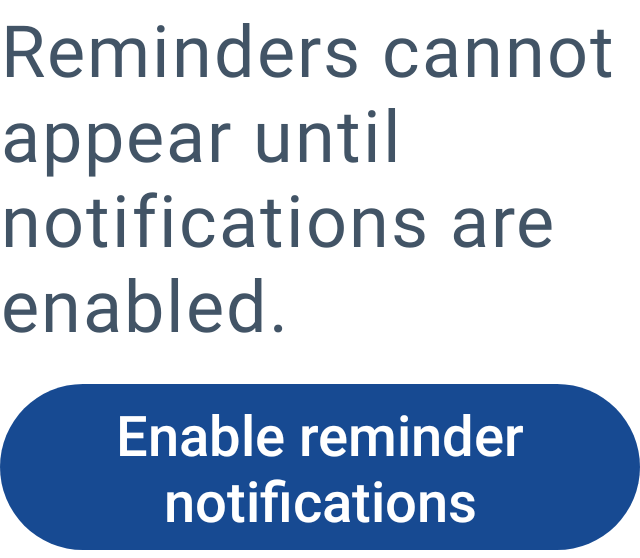
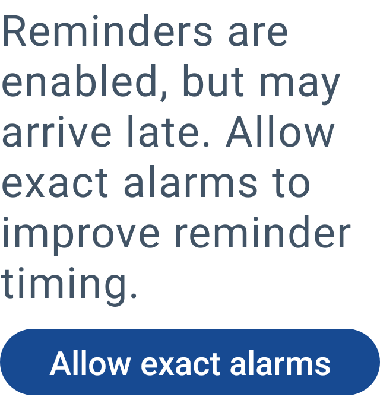

# Elder reminder permission feedback

Date: 2026-11-28

Owner: BRMRs integration follow-up for E/S1

Branch: `fix/18-reminder-permission-feedback`

Issue: [#18](https://github.com/BRMRs/group33/issues/18)

Implementation: [PR #161](https://github.com/BRMRs/group33/pull/161)

## Delivered slice

The main-source Elder dose panel now consumes the existing `ReminderCapabilitySnapshot` instead of
inferring delivery health from notification permission alone. The currently runnable authenticated
host for this panel remains `DebugChainApplication`; the Release application still has no production
`LiveElderDoses` provider, so this is a demo-host integration slice rather than Release delivery.

- Notification permission or channel denial is shown as **reminder delivery unavailable**. The
  first recoverable API 33 denial requests the runtime permission; a denial that can no longer be
  requested opens app-notification settings instead. A disabled channel also opens settings.
- Exact-alarm denial is shown as **reminder delivery degraded**, with an exact-alarm settings
  recovery action. The existing inexact fallback remains unchanged.
- Returning from settings refreshes the capability through the existing `onResume` path.
- Neither condition changes a dose occurrence to Missed or reports Server acceptance.

The user-facing copy and recovery actions are separate from dose-event status, in line with the
current glossary.

## TDD evidence

The agreed mapping seam is `ElderDoseScreen -> ReminderPermissionPrompt`. Review exposed a second
user-critical decision seam, `ReminderPermissionPrompt + Android permission state -> recovery
action`, which prevents a permanently denied API 33 permission from looping another unusable prompt.

1. The first focused test failed to compile because the screen had no capability/prompt boundary.
2. After adding that boundary, exact-alarm denial mapped to degraded.
3. The notification-denial test then failed because no unavailable presentation or bilingual
   resources existed; the minimum presentation mapping made it pass.
4. The 320dp/200%-font instrumentation test failed because the real permission-banner resource did
   not exist. The panel now inflates that shared-token layout in both tested widths and languages.
5. The first API 33 recovery test failed because no recovery decision existed; after the minimum
   request path passed, permanent-denial, rationale, notification-settings and exact-settings cases
   were added.
6. The integrated-panel test first failed to compile because `ElderDosePanel` had no injectable
   recovery boundary. The production constructor still owns the real Android permission launcher,
   while the final device test drives the same panel with an isolated lifecycle and verifies both
   capability states through visible copy and click dispatch.

Current local results:

```text
ElderDoseCapabilityPresentationTest                    8/8 pass
ElderReminderPermissionBannerLayoutTest (API 27)       4/4 pass
ElderReminderPermissionPanelDeviceTest (API 27)        2/2 pass
permissionRecoveryEntrypointsTargetThisApplication     1/1 pass
ReminderCapabilityDeviceTest (API 27)                  applicable cases pass;
                                                        API 31/33-only denial phases skip
```

The settings-intent device test verifies notification recovery targets this package and exact-alarm
recovery targets this package on API 31+, with the application-details fallback below API 31.
The [API35 workflow on implementation head `0e6de8e`](https://github.com/BRMRs/group33/actions/runs/46120281735)
passed with 20 unique boundary/UI tests, including four layout cases, one settings-intent case and
two integrated-panel cases. Three separate non-skipped capability phases also passed: notification
denial retained the same occurrence, notification grant recovered it, and exact-alarm denial reported
degraded while using the inexact fallback. The retained artifact records API35/x86_64, the exact head,
all three phases, dispatch/automatic/PostgreSQL recovery and emulator cleanup as passed. A UI mapping
test does not replace this platform evidence. Separate API31/33 image runs are not claimed by this
slice.

## Bilingual accessibility evidence

The images below are rendered by the production Android layout on the physical Xiaomi Mi Pad 4 Plus
(Android 8.1/API 27), using a 320dp configuration and 200% font scale. The same assertions run at
360dp. They require no text ellipsis, a shared-token action height of at least 64dp, and readable
accessibility-node text for both the explanation and action. Each state is stated in text and does
not depend on color, so its meaning remains available without color perception.

| State | English | Simplified Chinese |
|---|---|---|
| Unavailable |  |  |
| Degraded |  |  |

## Deliberately not claimed

- This slice does not add or change AlarmManager, notification-channel, Room, WorkManager, wire, or
  Server behavior.
- The Release application still supplies no production `LiveElderDoses` provider. This slice does
  not complete the designed full-screen ringing experience or a full TalkBack service walkthrough.
- It does not implement Server Help delivery, caregiver follow-up/probe delivery, or two-device P0
  acceptance. Issue #18 and the wider P0 loop remain open.
- Final-head required checks and non-author review remain merge gates.
